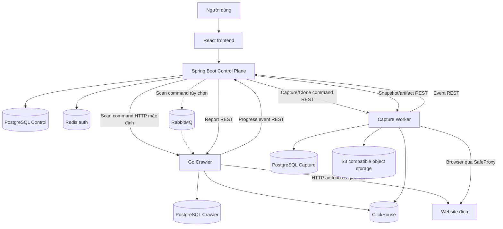
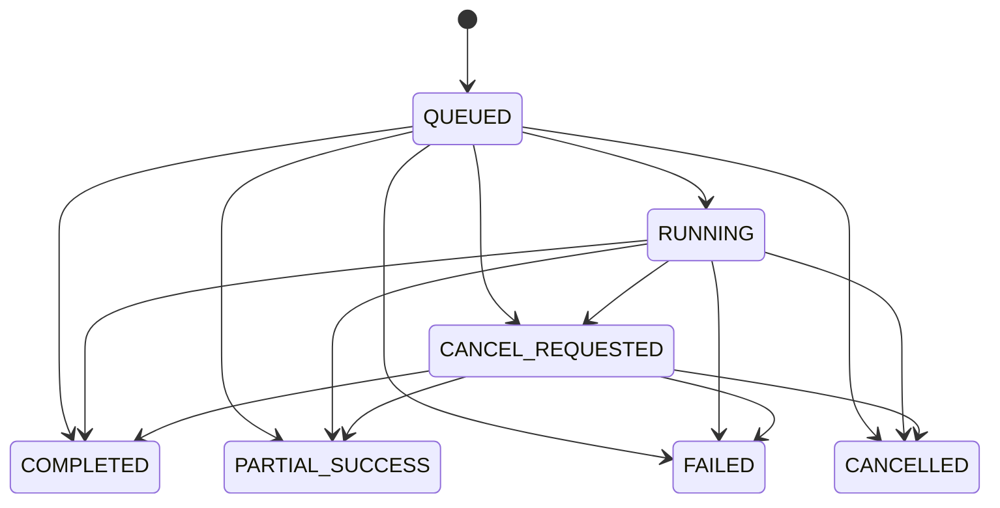

# WebLens — Hồ sơ dự án và bàn giao ngữ cảnh cho AI

**Ngày tổng hợp:** 23/10/2026, múi giờ Asia/Bangkok (UTC+7).  
**Snapshot mã nguồn:** `a430a1607213182ff0b73b14e03d5a69f57ce820`.  
**Đối tượng đọc:** chủ dự án, lập trình viên mới và AI tiếp nhận công việc.  
**Phương pháp:** phân tích tĩnh tài liệu, cấu hình, migration, mã nguồn và kiểm thử trong checkout hiện tại. Không kiểm tra trực tiếp VPS, không chạy lại benchmark hoặc full-stack E2E trong lần tổng hợp này.

Tài liệu này có thể gửi độc lập cho AI khác. Các đường dẫn trong dấu backtick là đường dẫn tính từ root repository để AI tra cứu khi được cấp mã nguồn. Các đoạn giả mã giải thích logic, không phải mã có thể chép vào production. Giá trị cấu hình được ghi là mặc định nguồn; môi trường đang chạy có thể override.

## Mục lục

1. [Tóm tắt để nắm dự án](#1-tóm-tắt-để-nắm-dự-án)
2. [Phạm vi đã có và lộ trình](#2-phạm-vi-đã-có-và-lộ-trình)
3. [Nguồn sự thật và cách đọc lịch sử](#3-nguồn-sự-thật-và-cách-đọc-lịch-sử)
4. [Cấu trúc repository và công nghệ](#4-cấu-trúc-repository-và-công-nghệ)
5. [Kiến trúc và quyền sở hữu](#5-kiến-trúc-và-quyền-sở-hữu)
6. [Khái niệm và định danh](#6-khái-niệm-và-định-danh)
7. [Luồng sản phẩm từ đầu đến cuối](#7-luồng-sản-phẩm-từ-đầu-đến-cuối)
8. [Đăng nhập, JWT, Redis và refresh rotation](#8-đăng-nhập-jwt-redis-và-refresh-rotation)
9. [Đăng ký và quản lý website](#9-đăng-ký-và-quản-lý-website)
10. [Tiếp nhận scan và idempotency](#10-tiếp-nhận-scan-và-idempotency)
11. [Thuật toán crawl](#11-thuật-toán-crawl)
12. [Phân tích HTML và deterministic findings](#12-phân-tích-html-và-deterministic-findings)
13. [Durable staging, ClickHouse và watermark](#13-durable-staging-clickhouse-và-watermark)
14. [Lifecycle, progress và cancellation](#14-lifecycle-progress-và-cancellation)
15. [Report, bộ lọc và phân trang](#15-report-bộ-lọc-và-phân-trang)
16. [Browser Capture](#16-browser-capture)
17. [Clone tĩnh một trang](#17-clone-tĩnh-một-trang)
18. [Design Clone toàn website](#18-design-clone-toàn-website)
19. [Phiên browser đăng nhập tạm thời](#19-phiên-browser-đăng-nhập-tạm-thời)
20. [Billing và thanh toán sandbox](#20-billing-và-thanh-toán-sandbox)
21. [API công khai và contract nội bộ](#21-api-công-khai-và-contract-nội-bộ)
22. [Dữ liệu, migration và retention](#22-dữ-liệu-migration-và-retention)
23. [Frontend và trạng thái giao diện](#23-frontend-và-trạng-thái-giao-diện)
24. [Bảo mật và giới hạn tin cậy](#24-bảo-mật-và-giới-hạn-tin-cậy)
25. [Cấu hình và cách chạy local](#25-cấu-hình-và-cách-chạy-local)
26. [Kiểm thử và bằng chứng hiện có](#26-kiểm-thử-và-bằng-chứng-hiện-có)
27. [Triển khai và vận hành](#27-triển-khai-và-vận-hành)
28. [Giới hạn, điểm chưa xác minh và cách chẩn đoán](#28-giới-hạn-điểm-chưa-xác-minh-và-cách-chẩn-đoán)
29. [Bản đồ đọc mã nguồn](#29-bản-đồ-đọc-mã-nguồn)
30. [Quy tắc tiếp tục phát triển và prompt bàn giao](#30-quy-tắc-tiếp-tục-phát-triển-và-prompt-bàn-giao)

---

## 1. Tóm tắt để nắm dự án

**WebLens là nền tảng thu thập bằng chứng kỹ thuật của website, quản lý lượt quét và tạo bản clone giao diện có giới hạn.** Người dùng đăng nhập, đăng ký website, yêu cầu scan, theo dõi tiến độ, đọc kết quả theo từng URL, mở Browser Capture để xem trang sau JavaScript, hoặc yêu cầu Design Clone bằng một URL đầu vào.

Vấn đề sản phẩm muốn giải quyết là thông tin kiểm tra website nằm rời rạc: hiệu năng, lỗi HTTP, nội dung, thay đổi sau deployment và bằng chứng để điều tra. Hướng dài hạn là trả lời “cái gì thay đổi, bằng chứng ở đâu, cần ưu tiên điều tra gì”. Nhưng snapshot hiện tại chủ yếu thực hiện thu thập và phân tích bằng quy tắc xác định; comparison/regression và AI giải thích vẫn ở lộ trình.

Có bốn khối mã chính:

- **React frontend:** giao diện dùng API thật.
- **Spring Boot Control Plane:** identity, authorization, website, tiếp nhận công việc, public lifecycle và API cho frontend.
- **Go Crawler:** tải HTTP(S), phát hiện URL, phân tích HTML, quản lý frontier bền vững và đưa dữ liệu phân tích sang ClickHouse.
- **Playwright Capture Worker:** chạy browser trong boundary riêng, thu bằng chứng sau render, tạo clone và quản lý artifact.

Ba khối backend thực thi là ba deployable đã được duyệt. Frontend là phần giao diện phục vụ qua web server. PostgreSQL, ClickHouse, Redis, object storage và RabbitMQ là các dependency hạ tầng; không phải các business service mới.

Điểm kỹ thuật cốt lõi là **độ tin cậy khi xử lý bất đồng bộ qua nhiều nơi lưu dữ liệu**:

1. Nhận công việc phải có bản ghi và outbox bền vững.
2. Command/event có thể được giao nhiều lần; inbox và version loại xử lý trùng.
3. Worker dùng lease và fencing để attempt cũ không ghi đè attempt mới.
4. PostgreSQL giữ workflow; ClickHouse giữ analytical facts; object storage giữ byte lớn.
5. Không có distributed transaction giữa các store. Staging, receipt, acknowledgement và watermark nối các bước.
6. Cấu hình trần lớn không phải bằng chứng hệ thống đạt capacity tương ứng.

### Những điều AI khác cần nhớ ngay

- Không mô tả dự án hiện tại là một chatbot hay một hệ thống AI đã làm root-cause analysis.
- Không chạy JavaScript website trong Java Control Plane hoặc Go Crawler.
- Không để frontend truy cập database, object store hoặc service nội bộ trực tiếp.
- Không coi timeout là bằng chứng thao tác từ xa đã rollback.
- Không coi `QUEUED` phía UI là bằng chứng Crawler chưa bắt đầu.
- Không coi `PUBLISHED` của Design Clone là đã sao lưu mọi URL của website.
- Không dùng public `succeededCount` làm số trang tính tiền.
- Không thay migration đã áp dụng hoặc tự thiết kế bảng ngoài quyền được duyệt.

## 2. Phạm vi đã có và lộ trình

| Nhóm | Trạng thái qua source/tài liệu | Ý nghĩa chính xác |
| --- | --- | --- |
| Authentication | Có implementation | Register/login, JWT access/refresh, rotation, CSRF, Redis session, durable revocation |
| Website management | Có implementation | Tạo, danh sách, xem, đổi tên, archive theo owner |
| Scan | Có implementation | Bounded HTTP crawl, progress, history, hủy, retry/recovery |
| Page report | Có implementation | HTML metadata, HTTP timing, deterministic findings, filter/cursor |
| Browser Capture | Có implementation | Rendered metadata, JPEG screenshot, resource/network evidence, lab measurements |
| Clone một trang | Có implementation | ZIP HTML/assets đã capture, manifest, best-effort, tải có thời hạn |
| Design Clone website | Có implementation | Scan mới, chọn trang đại diện, render, dedup, rewrite, ZIP shard |
| Interactive login | Có implementation | Người dùng nhập vào browser session qua screenshot/actions, RAM-only, TTL |
| Redis | Có implementation và ADR riêng | Chỉ registry phiên JWT, không giữ crawl queue |
| RabbitMQ | Có implementation tùy chọn | Chỉ command tạo/hủy scan; nguồn mặc định HTTP |
| Billing/payment | Có foundation và sandbox path | Feature flag tắt mặc định; chưa nối thu phí scan, không suy ra đã nhận tiền thật |
| So sánh scan/regression | V2, chưa được thể hiện là capability runtime hoàn chỉnh | Cần baseline/candidate, rule và compatibility policy |
| AI root-cause explanation | V3 | Cần evidence package, provider boundary và chống prompt injection |
| Schedule/alert | V4 | Chưa phải workflow monitoring định kỳ đã hoàn thiện |
| RAG/ML/Kubernetes/multi-region | Giai đoạn sau | Không tự thêm vào task hiện tại |

Các nhóm solo developer, freelancer và đội nhỏ trong Product là giả thuyết thị trường. Repository không chứng minh product-market fit, retention hay willingness-to-pay.

## 3. Nguồn sự thật và cách đọc lịch sử

Các tài liệu nền: `docs/PRODUCT.md`, `docs/REQUIREMENTS.md`, `docs/ARCHITECTURE.md`, `docs/adr/` và `tasks/`. Quyền làm database nằm ở `docs/database/DESIGN_GATES.md`. Quy tắc làm việc nằm ở `AGENTS.md` và các file cùng tên trong `backend/`, `frontend/`.

**Phải tách ba loại thông tin:**

- **Quyết định/requirement:** điều đã được yêu cầu hoặc được phép làm.
- **Implementation:** điều source hiện tại thực sự có.
- **Bằng chứng kiểm chứng:** điều đã chạy được ở một release, cấu hình, máy và thời điểm cụ thể.

Chúng không tự thay thế nhau. Một proposal có schema không đồng nghĩa được phép chạy migration. Một test đã pass tháng trước không chứng minh VPS hôm nay khỏe. Một route có controller không chứng minh đã có frontend tương ứng.

### Các khác biệt lịch sử đã đối chiếu

| Nội dung dễ hiểu nhầm | Cách hiểu trong snapshot này |
| --- | --- |
| ADR-001/POM nói modular monolith | Control Plane vẫn có module nội bộ; ADR-005 đã duyệt tách Crawler/Capture thành deployable riêng |
| Quy tắc ban đầu không tự thêm Redis/ClickHouse | ADR-006 duyệt ClickHouse; ADR-019 duyệt Redis riêng cho auth; không mở quyền dùng chúng cho mọi chức năng |
| Roadmap cũ “REST + PostgreSQL, chưa broker” | ADR-017 revision 3 và TASK-020 bổ sung RabbitMQ tùy chọn cho scan commands |
| V1/V1.5 “không phải billing platform đầy đủ” | Có billing foundation về sau; vẫn chưa có scan charging hoàn chỉnh hoặc LIVE payment được duyệt |
| Requirement cũ nói Chromium | Browser source mặc định Camoufox theo ADR-015; Chromium vẫn chọn thủ công |
| Production Compose | Có cấu hình container lịch sử; topology VPS được ghi nhận hiện nay là Windows-native theo ADR-010/016/018/019 |
| `KNOWN_ISSUES.md` ngày 27/09 nói auth chưa rate-limit | Source hiện có `AuthenticationRateLimitFilter`; không sao chép kết luận cũ thành hiện trạng |
| Crawler “repo boundary riêng” | ADR yêu cầu boundary/provenance riêng; checkout này chứa source dưới `crawler/`. Không tự suy ra đã có repo remote độc lập hoặc hoàn tất nghĩa vụ license |

Đây là phần giải thích tiến hóa đã có tài liệu/source, không phải phê duyệt mới. Nếu một task tương lai gặp mâu thuẫn chưa được giải thích bằng revision/ADR, phải dừng phần phụ thuộc và hỏi chủ dự án, không tự chọn thiết kế.

## 4. Cấu trúc repository và công nghệ

```text
Pet_project/
├── AGENTS.md
├── README.md
├── .env.example
├── backend/                 Spring Boot Control Plane
│   ├── pom.xml
│   ├── src/main/java/com/weblens/
│   ├── src/main/resources/application.yml
│   └── src/main/resources/db/migration/
├── frontend/                React UI, API adapter và UI tests
├── crawler/                 Go Crawler, AGPL provenance
│   ├── cmd/weblens-crawler/
│   ├── internal/
│   └── migrations/{postgresql,clickhouse}/
├── capture-worker/          Browser, capture, clone, storage
│   ├── src/
│   └── migrations/{postgresql,clickhouse}/
├── infra/                   Local Compose và deployment/runbook
├── tools/                   Verification, load harness, recovery tools
├── docs/                    Product, architecture, ADR, DB, test reports
├── tasks/                   TASK-001 đến TASK-020 và template
└── .github/workflows/ci-deploy.yml
```

### Phiên bản trong manifest được đọc

| Khối | Khai báo hiện có | Dependency có vai trò quan trọng |
| --- | --- | --- |
| Control Plane | Java 21, Spring Boot 3.5.16, Maven wrapper | Spring Security/OAuth2 JWT, JPA/Hibernate, JDBC, Redis, Flyway, RabbitMQ Java client, Actuator |
| Frontend | React 19.2.x, TypeScript 6.0.x, Vite 8.2.x, React Router 7.18.x | `lucide-react`, Vitest, Testing Library, oxlint |
| Crawler | `go 1.27.1` trong `go.mod` | pgx v5, clickhouse-go/v2, goquery, purell, uuid, amqp091-go |
| Capture | TypeScript 5.9.2, Node runtime | Playwright 1.63.x, camoufox-js 0.11.5, pg, ClickHouse client, S3 SDK, parse5, yazl |
| CI | Java 21; Go theo go.mod; Node 22.23.2 cho Capture; Node 24 cho frontend job | PostgreSQL 17.6 và ClickHouse 26.3 ở các CI service được khai báo |

Đây là phiên bản khai báo/range, không phải cam kết về phiên bản mới nhất ngoài Internet. Muốn tái lập dependency phải dùng lockfile và môi trường phù hợp; không tự thay major theo một hướng dẫn cũ.

## 5. Kiến trúc và quyền sở hữu



### 5.1 Control Plane

Sở hữu người dùng, session ledger, website ownership, public scan/capture/site-clone projection, admission, quota, idempotency, command outbox và event inbox. API là boundary duy nhất của frontend. Java không trực tiếp crawl HTML hay chạy browser.

Các module: `auth`, `website`, `scan`, `capture`, `siteclone`, `messaging`, `dashboard`, `billing`, `common`. Có interface lookup giữa một số module để giới hạn phụ thuộc; không coi tất cả repository/entity là public API nội bộ.

### 5.2 Go Crawler

Sở hữu execution thật của scan, frontier, host slots, lease, retries, HTTP evidence, parser, analytics staging và report contract. Crawler nhận opaque owner/website/scan IDs và service credential, không nhận JWT/cookie đăng nhập WebLens của người dùng.

### 5.3 Capture Worker

Sở hữu browser execution, capture jobs, snapshots, object references, network/resource analytics, reconstruction một trang và site-reconstruction. Site Clone dùng Crawler report để lấy ứng viên; Capture không thay Crawler làm durable crawl frontier.

### 5.4 Store nào giữ gì

| Store | Vai trò | Không được dùng thay cho |
| --- | --- | --- |
| PostgreSQL Control | Identity, owner scope, public lifecycle, messaging, billing foundation | Analytical page store đầy đủ |
| PostgreSQL Crawler | Workflow/frontier/lease và staging | Kho resource body/browser |
| PostgreSQL Capture | Capture/clone workflow và metadata artifact | Kho ZIP/HTML/image lớn |
| ClickHouse crawl | Metrics, findings, links, ingestion receipts | Queue, lock, quota, auth |
| ClickHouse capture | Rendered/network/resource analytical facts, receipts | Browser session hoặc object bytes |
| S3/MinIO/R2 compatible | HTML, screenshot, resource bodies, bundle, ZIP, manifest | Source of truth về owner/public lifecycle |
| Redis | Positive registry phiên JWT | Workflow queue hoặc bản sao mặc nhiên có thể dựng lại từ DB |
| RabbitMQ | Bàn giao command scan khi được bật | Source of truth về execution, inbox hoặc report |

Các database/role của từng service phải tách biệt dù có thể dùng chung một PostgreSQL cluster vật lý. ID đi qua contract không tạo cross-service FK. Không join trực tiếp bảng của service khác.

## 6. Khái niệm và định danh

| Thuật ngữ | Ý nghĩa |
| --- | --- |
| Website | Target HTTP(S) đã đăng ký, có owner, URL chuẩn hóa và trạng thái |
| Scan | Một yêu cầu crawl với snapshot cấu hình bất biến theo lượt |
| Crawl execution | Workflow thực thi scan trong Crawler PostgreSQL |
| Scan page | Một URL trong frontier của một execution; khác URL cùng site ở scan khác |
| Frontier | Tập URL đã phát hiện, còn chờ/đang xử lý/đã có kết quả |
| Finding | Phát hiện bằng một rule có ID/version và evidence |
| Capture request/job | Yêu cầu phía Control / execution phía Worker cho một page |
| Snapshot | Metadata/bằng chứng của một lần browser capture |
| Reconstruction | Bản đóng gói tĩnh; một trang hoặc workflow site clone |
| Outbox | Bản ghi cần gửi ra ngoài được commit cùng state cục bộ |
| Inbox | Dấu vết đã nhận message để dedup và kiểm tra collision |
| Lease | Quyền xử lý tạm thời có hạn sử dụng |
| Fencing generation | Số attempt tăng dần; attempt cũ bị từ chối publish |
| Watermark | Mốc/count xác nhận analytics đã publish; không phải transaction xuyên store |
| Correlation ID | ID nối request, command, worker và event để điều tra |

Phải phân biệt `scanId`, `pageId`, `captureId`, `snapshotId`, `siteCloneId`, `artifactId`, `messageId`, `leaseOwner`, `leaseGeneration` và version của aggregate. Cùng kiểu UUID không có nghĩa thay thế cho nhau. Tên tham số route frontend cũng không tự xác định primary key của database.

## 7. Luồng sản phẩm từ đầu đến cuối

### Luồng A — Scan và kiểm tra bằng chứng

1. Register/login và giữ access token trong RAM frontend.
2. Tạo website bằng URL HTTP(S); server chuẩn hóa và gắn owner.
3. Gửi tạo scan, nên kèm `Idempotency-Key`.
4. Control Plane commit `scans` + command outbox, trả resource accepted.
5. Dispatcher giao command; Crawler commit inbox + execution + seed page.
6. Worker claim URL, fetch, parse, phát hiện link, stage result.
7. Analytics sink ghi ClickHouse và ACK về PostgreSQL.
8. Progress event được gửi về Control Plane, UI poll public projection.
9. UI đọc report có filter/cursor qua Control Plane.
10. Người dùng có thể hủy hoặc tạo capture cho page đủ điều kiện.

### Luồng B — Browser Capture

Control authorize page/scan → lấy static observation từ Crawler → commit capture/outbox → Worker render/upload/stage → ClickHouse publish/ACK → event về Control → UI mở snapshot/screenshot/resource và tải ZIP một trang nếu có.

### Luồng C — Design Clone

Nhập URL → Control resolve/create website → tạo **scan mới** → chờ scan terminal → dispatch clone → Worker đọc toàn bộ tập ứng viên có giới hạn → chọn representative → render → dedup layout/assets → rewrite → tạo shard + manifest → publish → tải qua API có owner scope.

Với site cần đăng nhập, người dùng mở phiên browser tạm, tự nhập credential/OTP rồi bấm ready. Session đó độc lập với JWT đăng nhập WebLens.

## 8. Đăng nhập, JWT, Redis và refresh rotation

Nguồn chính: `auth/service/AuthenticationService.java`, `auth/security/JwtConfig.java`, `JwtTokenService.java`, `RedisSessionStore.java`, `AuthCookieFactory.java` dưới `backend/src/main/java/com/weblens/`.

### 8.1 Register/login

- Email đi qua `EmailAddress`; password được hash bằng BCrypt cost 12 qua `DelegatingPasswordEncoder`.
- Guard giới hạn password theo **72 byte UTF-8**, không chỉ 72 ký tự.
- Khi login, đọc credential snapshot trong transaction ngắn; BCrypt chạy ngoài SQL transaction.
- Sau BCrypt, khóa user và đọc lại status/version/password hash/email để tránh phát session trên credential đã đổi trong thời gian tính hash.
- Tạo `auth_sessions` cùng hash refresh JTI, hash CSRF và expiry trong SQL transaction.
- Sau SQL commit, tạo live session ở Redis; chỉ trả authentication thành công khi bước activation cần thiết đã xong.

SQL và Redis không có distributed transaction. Nếu SQL commit nhưng Redis lỗi, có thể có ledger row không dùng được; không vì vậy mà bỏ yêu cầu Redis để cho đăng nhập qua.

### 8.2 Nội dung token và lưu trữ ở client

JWT ký HS256, có issuer, audience, subject user UUID, JTI, `sid`, `token_type`, thời điểm cấp và hết hạn. Secret cấu hình là Base64 decode được tối thiểu 32 byte.

- Access TTL nguồn: 15 phút; trả trong JSON và frontend giữ trong biến module RAM.
- Refresh TTL nguồn: 7 ngày; cookie `WEBLENS_REFRESH`, HttpOnly, SameSite Strict, path `/api/v1/auth`, Secure theo cấu hình.
- CSRF cookie `XSRF-TOKEN` đọc được bằng JavaScript; refresh/logout gửi `X-XSRF-TOKEN` và server kiểm tra hash gắn session.
- Reload trang có thể khôi phục access bằng refresh; không cần lưu access vào localStorage.

### 8.3 Access validation

```text
verify signature + issuer + audience + token type + required claims + time
extract userId, sid
require Redis session belongs to user
require auth_sessions row belongs to user, not revoked, not expired
otherwise reject
```

Redis là positive registry: thiếu key không tự dựng lại để cấp quyền. Durable revocation trong PostgreSQL ngăn snapshot Redis cũ làm sống lại session đã logout. Lỗi Redis hoặc session ledger trả lỗi availability (503 theo error handling), không fallback bỏ kiểm tra.

### 8.4 Refresh rotation và race

1. Decode refresh token và kiểm tra Redis khớp owner + hash JTI cũ.
2. Khóa session SQL bằng `FOR UPDATE`.
3. Kiểm tra session usable, owner, JTI hash, CSRF hash và user active.
4. Sinh cặp token/CSRF mới; thay hash/expiry trong SQL rồi commit.
5. Redis Lua compare-and-set chỉ thay từ giá trị cũ sang mới nếu giá trị cũ còn khớp.
6. Nếu logout đã xóa Redis key, rotate không được tạo lại session.

Hai refresh đồng thời không được cùng sử dụng credential cũ thành công. Frontend dùng một promise `refreshInFlight` để gom refresh đồng thời trong một tab/process JS. Race nhiều tab và lỗi giữa SQL/Redis vẫn có thể yêu cầu đăng nhập lại; không được diễn giải rotation là atomic cross-store.

Logout commit SQL revocation trước, sau đó revoke Redis. Access cũ bị từ chối theo session. Redis mất dữ liệu có thể buộc người dùng đăng nhập lại; restart có persistence không đồng nghĩa chắc chắn mất toàn bộ session.

### 8.5 Rate limit hiện có

`AuthenticationRateLimitFilter` áp dụng POST register/login/refresh: tối đa 60 request/phút theo địa chỉ và semaphore 4 request auth đồng thời trên một Control Plane process; map cửa sổ được chặn 10.000 entries. Bị giới hạn trả 429 + `Retry-After: 60`. Chỉ tin forwarded header theo logic proxy loopback đã viết. Đây là cơ chế single-node; không phải limiter phân tán cho nhiều replica.

## 9. Đăng ký và quản lý website

`WebsiteTarget.parse()` kiểm scheme HTTP(S), authority, userinfo, fragment, host/port, chuyển IDN về ASCII, lowercase host, bỏ default port, thêm `/` khi thiếu path và normalize URI. Những hostname rõ ràng nội bộ bị loại.

Validation đăng ký chủ yếu là syntax và một số địa chỉ rõ ràng không public. Nó **không thay** DNS/IP validation lúc Crawler/Browser kết nối. Một domain hợp lệ ở thời điểm đăng ký vẫn có thể resolve sang IP bị cấm khi chạy.

Quy tắc chính:

- Website active trùng URL chuẩn hóa trong cùng owner bị conflict; owner khác có thể đăng ký cùng website.
- Rename thay display name; không suy ra được phép đổi target URL trong PATCH.
- DELETE website hiện là **archive**, không phải xóa sạch lịch sử/cross-store data.
- Không archive khi còn scan active.
- Danh sách có filter, sort allowlist và phân trang tối đa 100 item.
- Latest scan được tra theo tập website của page để tránh một remote call cho mỗi item.

Nguồn: `website/service/WebsiteService.java`, `WebsiteAccessService.java`, `website/model/WebsiteTarget.java`, migration `V1` và repository tương ứng.

## 10. Tiếp nhận scan và idempotency

### 10.1 Admission phía Control Plane

`ScanService.create()` khóa active user rồi khóa website active thuộc owner. Nó kiểm target, key, scan đang hoạt động và quota trước khi tạo row.

- Mỗi user tối đa **3 scan active** (`QUEUED`, `RUNNING`, `CANCEL_REQUESTED`).
- Mỗi website tối đa **1 scan active**, có cả database unique protection.
- Cấu hình scan được snapshot vào `ScanEntity`: max pages/depth/bytes/time/redirects/concurrency và collector version.
- Sau này đổi env không làm scan cũ đổi giới hạn.
- `scans` và `outbox_events` được commit cùng transaction. Không gọi Crawler trong transaction admission.

### 10.2 Key và fingerprint

Key scan/capture là tùy chọn ở API; Site Clone và payment order yêu cầu key. `IdempotencyKeyService` strip key, giới hạn 1–128 ký tự, lưu SHA-256. Fingerprint của tạo scan là hash operation + website ID.

```text
key absent -> tạo request theo các guard bình thường
key found + fingerprint equal -> replay kết quả đã nhận
key found + fingerprint different -> 409 IDEMPOTENCY_KEY_REUSED
key new -> tạo aggregate + outbox trong cùng transaction
```

Idempotency không chỉ là chặn double-click bằng disable nút. Retry sau mất response phải dùng lại key cũ; key mới là yêu cầu mới và có thể bị active-scan guard.

### 10.3 Bàn giao command

Envelope gồm `messageId`, `aggregateType`, `aggregateId`, `aggregateVersion`, `messageType`, `contractVersion`, `correlationId`, `occurredAt`, `payload`. Một số implementation gọi trường nội bộ là event type; wire contract phải đọc DTO/schema tương ứng.

Dispatcher claim outbox bằng lease, gửi ngoài transaction rồi ACK hoặc lên lịch retry. Retry giữ message ID. Crawler inbox kiểm checksum payload và aggregate để phân biệt:

- Cùng ID, cùng nội dung: duplicate hợp lệ.
- Cùng ID, khác nội dung: message collision, bị từ chối.
- Execution cùng scan đã tồn tại nhưng command không tương thích: conflict.
- Version cũ/hợp lệ đã có: ghi nhận ignored thay vì tạo execution mới.

Đây là delivery **at-least-once** kết hợp hiệu ứng nghiệp vụ idempotent, không phải cam kết “mỗi message chỉ được gửi đúng một lần”.

## 11. Thuật toán crawl

Nguồn trọng tâm: `crawler/internal/crawl/`, `crawler/internal/postgres/store.go`, `crawler/internal/config/config.go`.

### 11.1 Bài toán đồ thị

Mô hình website là đồ thị có hướng `G = (V, E)`: node là URL chuẩn hóa, cạnh là hyperlink. Seed có depth 0; trang con có depth của cha + 1. Crawler tìm phần đồ thị reachable trong giới hạn page/depth/duration và network policy.

Đây là **durable frontier với scheduling đồng thời**, không nên mô tả là DFS đệ quy hay BFS đồng bộ tuyệt đối. Claim sắp theo priority/discovery time/ID, còn thứ tự hoàn tất phụ thuộc mạng, retry, host slot và worker.

### 11.2 Chuẩn hóa URL và dedup

Normalizer dùng purell với các cờ: lowercase scheme/host, chuẩn hóa escape, decode unnecessary escapes, bỏ default port, empty query separator, fragment, slash lặp và sort query. Sau đó bỏ các tracking parameter đã liệt kê như `utm_source`, `utm_medium`, `utm_campaign`, `fbclid`, `gclid`, `mc_cid`, `mc_eid`; thêm `/` nếu host có nhưng path rỗng.

Ví dụ minh họa:

```text
HTTPS://EXAMPLE.COM:443/products?id=12&utm_source=mail#reviews
-> https://example.com/products?id=12
```

URL được băm SHA-256 để hỗ trợ khóa/index. Database uniqueness còn gồm URL thực, không chỉ giả định hash không bao giờ collision:

```text
(retention_month, execution_id, normalized_url_sha256, normalized_url)
```

Dedup chỉ trong execution tương ứng. Không gộp hai scan khác thời điểm thành một bản evidence.

### 11.3 Scope khác nhau giữa crawl và clone

Crawl URL/redirect cần HTTP(S), không userinfo và **cùng hostname** đã đăng ký. Hostname so sánh không tự đồng nghĩa same-origin: origin còn gồm scheme và port. Design Clone/asset policy ở các phần sau kiểm **same-origin** chặt hơn. Không dùng một normalizer cho mọi ngữ cảnh mà chưa xem contract.

### 11.4 Giả mã pipeline

```text
accept command transactionally:
    validate contract + dedup inbox
    create crawl_execution
    insert seed page QUEUED, depth=0
    initialize host slots
    commit inbox + workflow

dispatcher while service alive:
    if analytics backlog too old or backlog check fails:
        pause new claims
    reserve global fetch capacity
    run at most 4 concurrent DB claim attempts
    for each successful claim:
        start page attempt with scan deadline and heartbeat
        fetch outside DB transaction
        parse result and derive deterministic findings
        commit under valid lease generation:
            retry transient failure if attempts remain
            otherwise mark PERSISTING
            insert new eligible discovered links within page/depth budget
            stage analytics payload
            advance execution counters/outbox
    if no claim succeeds: wait poll interval

analytics sink:
    publish staged facts -> receipt -> SQL ACK
    finalize page counters
    terminalize scan only when outstanding work is drained
```

### 11.5 Claim, fairness và host politeness

Claim dùng transaction ngắn với `FOR UPDATE ... SKIP LOCKED`. Execution đủ điều kiện phải còn thời hạn, active, có queued page và chưa đạt concurrency. Ưu tiên execution có ít lease hơn, sau đó ít hoạt động gần đây hơn theo `updated_at`, `accepted_at`, ID.

Tiếp theo claim host slot rồi page. Host slot có lease/generation riêng, `next_allowed_at` và slot number. Đây là state chung trong Crawler DB để phối hợp nhiều instance, khác giới hạn connection của một `http.Transport`.

Mặc định nguồn:

- Global fetch ceiling: 10.000.
- DB claim concurrency: tối đa 4, dùng chung fetch budget; không tạo 10.000 polling loop lúc idle.
- Host concurrency: 2; host delay 1 giây trên logic slot.
- Lease: 30 giây; heartbeat interval `max(lease/3, 1 giây)`.
- Poll frontier: 250 ms; reclaimer tick 5 giây.
- Host concurrency trên 2 đòi `CRAWLER_LOCAL_TARGETS_ONLY=true` và chỉ cho fixture/private-local policy.

Không diễn giải 2 slot + delay thành cam kết một RPS cố định cho toàn hostname; cần đo hành vi slot/request trên workload cụ thể. Fairness theo occupancy/activity cũng không phải strict round-robin.

### 11.6 Lease/fencing: ví dụ race

```text
Worker A claim page, generation=7
A bị treo, lease hết hạn
Worker B reclaim/claim, generation=8
B fetch và commit thành công
A chạy lại, cố commit generation=7
WHERE lease_owner/generation/expiry không còn khớp -> stale lease
```

Commit/heartbeat kiểm page owner + generation + expiry và host generation tương ứng. Việc “A từng có quyền” không đủ. Khi heartbeat thất bại, attempt bị cancel; fencing vẫn là guard chống publication muộn.

### 11.7 Fetch và SSRF

SafeDialer resolve hostname, từ chối nếu **bất kỳ** DNS answer không được phép, rồi kết nối trực tiếp IP đã kiểm tra. IPv4-mapped IPv6 được normalize. Policy chặn private/loopback/link-local/multicast/unspecified và các range reserved được liệt kê. Proxy môi trường bị bỏ qua (`Proxy: nil`). TLS validation vẫn bật.

Redirect kiểm lại hostname/count; destination connection vẫn qua SafeDialer. Timeout kết nối/TLS/header/body và deadline scan đều có vai trò riêng. Fetch body đọc tối đa `maxBodyBytes + 1` để nhận biết vượt trần, không parse body đã cắt như evidence đầy đủ.

HTTP tracing ghi DNS/connect/TLS/TTFB/total với cờ `Observed`. Keep-alive có thể không thực hiện lại DNS/TLS, nên không được thay “không quan sát” bằng “0 ms thực đo”. TTFB HTTP trong fetcher tính từ request ban đầu tới first byte của response cuối sau redirect; không đồng nhất với lab browser navigation TTFB.

### 11.8 Retry

Page attempt tối đa 3. Retry các error transient được phân loại (`timeout`, `dns_failed`, `network_failed`, `body_read_failed`) và HTTP 429, 500, 502, 503, 504. Không retry mọi 5xx như 501/505.

Page delay dùng exponential backoff có deterministic jitter từ byte đầu UUID: base `2^(attempt-1) × 2 giây`, delay nằm trong khoảng xấp xỉ base/2 đến base. Delivery analytics/event có hàm delay khác, chặn số mũ tối đa 8. Chặn số mũ không mặc nhiên nghĩa toàn bộ delivery chỉ retry 8 lần; phải đọc policy của từng queue.

`Retry-After` của website chưa được giữ trong `FetchResult` để điều khiển page retry hiện tại. Đây là giới hạn thực tế, không nên mô tả là crawler đã tôn trọng đầy đủ header đó.

### 11.9 Phát hiện URL mới và giới hạn

Trong transaction commit result, khóa execution, tính `remaining = maxPages - discoveredCount`, chỉ thêm link internal + followable + in-scope, dedup trong batch và `ON CONFLICT DO NOTHING` ở DB. Chỉ rows insert thật mới tăng discovered/queued. Nếu depth hiện tại đã đạt max depth thì không mở rộng.

Mặc định scan: 100.000 page, depth 4, response 10 MiB, duration 24 giờ, 5 redirects, concurrency 10.000. Các trần phối hợp nhau; đặt maxPages 100.000 không đảm bảo sẽ tìm hoặc xử lý đủ 100.000 trang.

### 11.10 Độ phức tạp và giới hạn thuật toán

Mô hình graph traversal lý tưởng gần `O(V + E)` với hash dedup; runtime thật còn có SQL/index/lock, parse body, network latency, retries và ClickHouse ingestion. Bộ nhớ bị chi phối bởi các attempt đồng thời và body/parser/batch, không chỉ số URL.

Nguồn hiện tại phát hiện URL chủ yếu từ HTML links. Không tìm thấy pipeline sitemap riêng trong `crawler/internal/`; không coi việc architecture nhắc sitemap là implementation đã hoàn thiện. Crawler không cưỡng chế `robots.txt` theo quyết định operator ở ADR-011; các guard network, bounds và politeness vẫn giữ.

## 12. Phân tích HTML và deterministic findings

Nguồn: `crawler/internal/crawl/parser.go` và `buildResult()` trong `engine.go`.

### 12.1 Dữ liệu được trích

Parser dùng goquery để đọc title, meta description/keywords/robots, canonical, HTML language, H1–H6, hreflang, Open Graph, structured-data summary, word count, image/alt, script/stylesheet count và các link. Parser có các bound riêng cho text, số item và JSON-LD; ví dụ JSON-LD tối đa 20 block và tổng 1 MiB trong logic extraction.

Link đến từ `a, area`; được resolve theo URL base và chuẩn hóa. Link metadata và frontier eligibility là hai khái niệm khác nhau: external hoặc nofollow có thể được ghi làm bằng chứng nhưng không mở rộng crawl.

Heading/image logic có xét accessible name như `aria-label`, `aria-labelledby`, text và ảnh trang trí. Vì vậy “không có alt attribute” không luôn đồng nghĩa finding `IMAGE_ALT_MISSING`; phải dùng đúng rule hiện tại.

Structured-data extraction chủ yếu phát hiện/parse JSON-LD, microdata types và summary/issue codes. Đây không phải full Schema.org semantic validator hoặc chứng nhận Google rich-results eligibility.

### 12.2 Phân loại fetch outcome

| Tình huống | Cách xử lý chính trong `buildResult()` |
| --- | --- |
| SSRF hoặc redirect ra ngoài scope | `SKIPPED`, finding policy-blocked |
| Network/timeout error | `FAILED`, finding fetch-failed; có thể được retry trước khi stage terminal |
| Body vượt giới hạn | `FAILED`, `BODY_TRUNCATED`; không dùng HTML cắt làm evidence đầy đủ |
| HTTP từ 400 | `HTTP_ERROR`, finding HTTP error |
| HTTP không lỗi | `SUCCESS`, tiếp tục parse nếu HTML |
| Content type không phải HTML | Không chạy các rule HTML |
| Parse HTML thất bại | `FAILED`, `HTML_PARSE_FAILED` |

Outcome thành công của fetch không có nghĩa trang không có finding, không có nghĩa HTML 2xx đủ điều kiện billing, cũng không đồng nghĩa mọi page của site đều tốt.

### 12.3 Các rule hiện có

| Rule ID | Version | Code/ý nghĩa |
| --- | --- | --- |
| `fetch.policy-blocked` | 1 | `FETCH_BLOCKED_BY_POLICY` |
| `fetch.failed` | 1 | `FETCH_FAILED` |
| `fetch.body-truncated` | 1 | `BODY_TRUNCATED` |
| `http.error` | 1 | `HTTP_ERROR` |
| `http.redirect-response` | 1 | `HTTP_REDIRECT_RESPONSE` khi final còn 3xx |
| `redirect.chain` | 1 | `REDIRECT_CHAIN` khi có nhiều hơn một redirect |
| `title.missing` | 2 | `TITLE_MISSING` |
| `meta-description.missing` | 2 | `META_DESCRIPTION_MISSING` |
| `h1.missing` | 2 | `H1_MISSING` |
| `image.alt.missing` | 2 | `IMAGE_ALT_MISSING` |
| `canonical.invalid` | 1 | `CANONICAL_INVALID` |
| `canonical.multiple` | 1 | `CANONICAL_MULTIPLE` |
| `canonical.noindex-conflict` | 1 | `CANONICAL_NOINDEX_CONFLICT` |
| `hreflang.invalid` | 1 | `HREFLANG_INVALID` |
| `structured-data.invalid` | 1 | `STRUCTURED_DATA_INVALID` |

Các rule thiếu title/description/H1/alt và SEO tương ứng chỉ chạy ở nhánh HTML đủ điều kiện, không áp lên mọi lỗi mạng. Mỗi finding có category, severity, code, message và evidence. Finding ID được tạo xác định bằng `uuid.NewSHA1(pageId, ruleId + ':' + ruleVersion)`; đây là identity ổn định cho rule/page/version, không phải thuật toán bảo mật password.

### 12.4 Indexability

```text
if HTTP không phải 2xx -> HTTP_STATUS_NOT_INDEXABLE
else if meta và generic X-Robots đều noindex -> META_AND_X_ROBOTS_NOINDEX
else if generic X-Robots noindex -> X_ROBOTS_TAG_NOINDEX
else if meta noindex -> META_ROBOTS_NOINDEX
else -> INDEXABLE
```

Token `none` cũng được nhận là noindex. X-Robots giữ boundary giữa các header field và phân biệt directive target riêng user-agent với generic directive.

`INDEXABLE` chỉ nghĩa vượt các kiểm tra này. Nó không chứng minh Google đã index trang, không kiểm tra toàn bộ crawlability/robots/search-console hay canonical cluster trên Internet.

## 13. Durable staging, ClickHouse và watermark

Nguồn: `crawler/internal/postgres/store.go`, `crawler/internal/analytics/{worker,clickhouse,reports}.go`, các migration ClickHouse; Capture có pipeline tương tự ở `database.ts`, `analytics.ts`, `index.ts`.

### 13.1 Vì sao có trạng thái PERSISTING

Sau fetch không thể vừa ghi PostgreSQL vừa ghi ClickHouse một cách atomic bằng một local transaction. Nếu tăng “processed” và báo complete trước insert ClickHouse, người dùng có thể thấy scan xong nhưng không có evidence.

Crawler giải quyết bằng thứ tự:

```text
fetch result trong RAM
    -> PostgreSQL: page PERSISTING + pending terminal status
       + analytics_outbox payload/checksum/version
       + expected count tăng
    -> ClickHouse: metrics + findings + links
    -> ClickHouse: ingestion receipt
    -> PostgreSQL ACK: outbox delivered, page terminal,
       published count tăng, counters cập nhật, progress event
```

Analytics payload có schema version, owner, scan, page, retention month, record version, requested/normalized/final URL, result, collector và parser version. Source ghi parser version `weblens-parser-v3`; payload quá 4 MiB bị chặn.

### 13.2 Batch và retry

Crawler analytics worker claim tối đa 100 outbox rows mỗi batch. Sink kiểm payload/hash, tra receipts đã có, insert các nhóm fact cần thiết rồi ghi receipt. PostgreSQL ACK chỉ sau delivery thành công. ACK SQL xóa payload đã delivered khỏi row để giảm lưu trữ, giữ metadata phục vụ workflow.

Các bảng analytical dùng logical key/version với `ReplacingMergeTree`; report đọc view `*_current` có `FINAL`/delete filtering theo migration. Không dùng `COUNT(*)` trên raw table để suy số page duy nhất khi retry có thể tạo nhiều physical rows trước merge.

### 13.3 Các cửa sổ lỗi cần hiểu

| Điểm lỗi | Hậu quả và cơ chế phục hồi |
| --- | --- |
| Crash trước PostgreSQL result commit | Chưa có result durable; lease expiry cho phép attempt khác |
| SQL stage xong, chưa ghi ClickHouse | Outbox còn payload để publish lại |
| Một số table ClickHouse đã insert, chưa có receipt | Retry có thể insert lại; logical version/current view phải chống double count |
| Receipt có, SQL ACK bị mất | Retry đọc receipt, tiếp tục ACK mà không cần giả định insert thất bại |
| SQL ACK xong, event chưa tới Control | Crawler event outbox còn; projection UI có thể trễ |
| Control nhận event nhưng response bị mất | Giao lại cùng ID; inbox bỏ duplicate |

Không có transaction xuyên PostgreSQL/ClickHouse. Report trong lúc indexing có thể thấy dữ liệu dần xuất hiện; list/summary/state không phải snapshot atomic chung giữa hai store. Watermark mô tả publication progress, không biến một query đang chạy thành snapshot isolation liên service.

### 13.4 Terminalization và backpressure

Điều kiện drain trọng tâm của Crawler:

```text
queued_count = 0
leased_count = 0
persisting_count = 0
analytics_published_count = analytics_expected_count
```

State terminal được chọn theo cancel/success/failure/skipped và các reason code. Event terminal không bị chặn bởi throttle progress thông thường.

Nếu pending analytics cũ hơn ngưỡng 15 phút mặc định, Engine tạm dừng claim page mới. Nếu kiểm backlog lỗi, nó cũng pause theo hướng fail closed. Khi backlog hồi phục thì resume. Chỉ tăng fetch concurrency trong lúc ClickHouse kẹt có thể làm backlog xấu hơn.

### 13.5 Vì sao tách đọc/ghi

Crawler có pool ClickHouse đọc riêng mặc định 7 connection và ghi riêng 3. Trần pool đọc cấu hình 1–64. Control Plane còn có bulkhead report riêng. Các budget khác nhau ngăn report chiếm sạch tài nguyên ingestion; chúng không chứng minh throughput cụ thể. Crawler có tùy chọn HTTPS endpoint cho cùng provider, còn migration dùng native path theo runbook.

## 14. Lifecycle, progress và cancellation

### 14.1 Public scan state



Terminal: `COMPLETED`, `PARTIAL_SUCCESS`, `FAILED`, `CANCELLED`. Terminal không được mở lại bằng event tiếp theo. Event terminal có thể tới trước progress đầu tiên, nên `QUEUED → COMPLETED` là hợp lệ.

### 14.2 Cách map counters

Crawler có counters chi tiết queued, leased, persisting, succeeded, failed, skipped, cancelled. Event public gộp:

```text
publicQueued    = queued + leased + persisting
publicSucceeded = succeeded
publicFailed    = failed + skipped + cancelled
publicProcessed = publicSucceeded + publicFailed
```

Do đó public `queued` bao gồm cả work đã claim hoặc đang chờ persistence, và public `failed` không chỉ lỗi HTTP/network. Domain invariants gồm không âm, không vượt page limit/discovered, `processed = succeeded + failed`; consumer còn kiểm `queued + processed <= discovered`.

UI cần đọc terminal reason và page evidence để hiểu thiếu dữ liệu, không chỉ tô màu theo một counter.

### 14.3 Projection và version

`ScanEntity.applyRemoteProjection()` bỏ version không lớn hơn version đã áp dụng và không đổi aggregate đã terminal. Progress event newer có thể thay counters mà không đổi lifecycle. Nếu user đã yêu cầu hủy, progress RUNNING đến muộn không được làm mất `CANCEL_REQUESTED`.

Progress source được coalesce tối đa khoảng một lần/giây/scan khi cùng trạng thái; đổi state/terminal không bị giới hạn đó. Vì vậy aggregate version có thể nhảy; consumer không được đòi nhận đủ mọi số liên tiếp.

### 14.4 Cancellation race

Control nhận hủy chỉ ghi `CANCEL_REQUESTED` và outbox. Crawler mới xác nhận terminal. Nếu Crawler đã xong trước khi thấy lệnh hủy, completion event vẫn hợp lệ. Nếu work còn chạy, cancellation xử lý queued/leased rows và fencing ngăn result attempt cũ publish.

Hủy accepted không có nghĩa mọi socket/browser dừng tức thời. DB fencing bảo vệ correctness; thời gian dừng process và cleanup phải được kiểm riêng. Với scan bị hủy còn result `PERSISTING`, cần drain publication liên quan trước trạng thái cuối phù hợp.

## 15. Report, bộ lọc và phân trang

`ScanReportService` authorize owner trong Control Plane rồi gọi `CrawlerReportClient` ngoài SQL transaction. Crawler query owner-scoped và đọc workflow state thật trước report; frontend không đọc ClickHouse trực tiếp.

### 15.1 Hai kiểu pagination

| Collection | Kiểu | Lý do |
| --- | --- | --- |
| Website, scan history, clone history | Page number + size | Quản lý danh sách metadata; allowlist sort, tie-break bằng ID |
| Scan pages | Keyset/cursor | Tránh deep OFFSET cho tập URL lớn |
| Clone Render Monitor | Ordinal cursor `after` | Duyệt page-work có thứ tự trong job |
| Billing ledger | Cặp time + ID | History keyset; cần đủ cả hai thành phần cursor |

Page report query có thứ tự `(normalized_url, page_id)`; request sau dùng điều kiện tuple lớn hơn cursor, lấy `limit + 1` để biết còn page. Cursor chứa URL, ID và filter fingerprint; đổi filter nhưng dùng cursor cũ bị từ chối. Base64 encoding không phải authorization.

Đang crawl có thể thêm URL sắp trước cursor đã đọc. Vì vậy keyset có ordering ổn định nhưng không hứa một lượt duyệt active scan là snapshot toàn bộ bất biến; refresh/tải lại từ đầu hoặc đợi terminal khi cần tập hoàn chỉnh.

### 15.2 Filter và aggregate

Filter gồm issues-only, outcome, status range, query URL, indexable, content type, severity, finding code. Giá trị enum/range/list length được giới hạn. SQL dùng parameter cho input và identifier/sort allowlist.

`issuesOnly` gồm fetch/status có lỗi hoặc finding severity warning/error/critical theo logic nguồn; finding INFO đơn lẻ không luôn khiến trang vào nhóm issues. Report summary gồm tổng URL, issue pages, finding count, 2xx/3xx/4xx/5xx/no-response; không cộng số item của một page để thay aggregate toàn scan. Summary không mặc nhiên theo tất cả filter của list; phải xem contract hiện hành trước đổi UI.

Findings được query theo tập page IDs và map về pages; không tạo một query findings cho mỗi row. Read admission slot được trả trước bước query findings tiếp theo để tránh giữ slot thừa.

### 15.3 Empty, stale và unavailable

Crawler chỉ dùng shortcut report rỗng khi authoritative `expected = published = 0`, sau validate owner/filter/cursor. Không dùng projection `processed = 0` của Control để kết luận chưa có analytics.

Control có semaphore report mặc định 8 slot, `tryAcquire` fail-fast có thể trả 503 `SCAN_REPORT_BUSY`. Đây là load shedding đã có, khác timeout TCP và khác mất scan. Khi service/report lỗi, UI cần hiển thị unavailable/stale, không bịa kết quả rỗng hoặc đánh scan failed.

## 16. Browser Capture

### 16.1 Admission

`CaptureService.create()` kiểm replay, gọi Crawler lấy page ngoài SQL transaction, rồi trong write transaction khóa owner và kiểm scan/page scope, eligibility, duplicate active capture trước tạo capture/outbox. Page phải có outcome `success` theo report contract. Target dùng final URL nếu có. Static observation đóng gói title/description/canonical/H1/counts/schema/time để đối chiếu sau render.

Public Capture statuses được khai báo riêng với Scan, có các bước dispatch/running/indexing và terminal; không được dùng enum Scan thay thế. Snapshot/artifact chỉ mở khi capture ready theo guard service.

### 16.2 Browser engine và isolation

`browser.ts` là launcher dùng chung cho capture và interactive session. Mặc định nguồn là Camoufox; `CAPTURE_BROWSER_ENGINE=playwright` chọn Chromium. Headless mặc định true, Chromium stealth mặc định false. Không còn SeleniumBase runtime/CDP theo ADR-015.

Browser dùng environment allowlist, không kế thừa mọi service secret. Context chặn downloads/service workers. Browser đi qua SafeProxy; WebRTC bị chặn ở cấu hình Camoufox. Trên Windows headless, source tắt Gamepad API vì crash Session 0 đã được ghi nhận.

SafeProxy resolve/check IP và connect vào IP đã kiểm cho HTTP, HTTPS CONNECT và upgrade; đếm incoming transfer bytes, timeout và đóng socket khi vượt budget. Đây là guard ở application layer; yêu cầu network-level egress isolation của deployment vẫn cần bằng chứng riêng.

### 16.3 Bound mặc định của page capture

| Thuộc tính | Giá trị trong entity/source |
| --- | --- |
| Measurement profile | `desktop-lab-v1` |
| Viewport yêu cầu | 1365 × 768; Camoufox dùng kích thước window và trả viewport thực khi cần |
| Capture timeout | 30 giây |
| Total bytes | 50 MiB |
| Mỗi resource body | 10 MiB |
| Network requests | 500 |
| Resource bodies | 100 |
| Ordinary capture worker concurrency | 2 process-local mặc định |

Ngoài render timeout còn có deadline attempt/upload/DB/cleanup. Thời gian accepted → artifact có thể lớn hơn 30 giây vì queue, browser startup, upload, retries và analytics publication.

### 16.4 Thuật toán render

```text
validate target public HTTP(S)
start SafeProxy + browser/context nếu không dùng interactive context
install PerformanceObserver trước navigation
route requests với DNS/public policy + request budget
record request/response/failure metadata theo sequence
navigate -> bounded hover/scroll/expansion -> wait còn trong deadline
extract rendered metadata, lab metrics, page HTML, viewport JPEG nếu cần
collect eligible resource bodies trong count/byte/time budget
create static reconstruction hoặc site bundle
upload objects ngoài DB transaction
stage metadata + analytics + reconstruction dưới lease generation hợp lệ
publish analytical facts -> SQL ACK -> terminal event
cleanup page/context/browser/proxy/temp theo ownership
```

Resource types có body candidate là stylesheet/script/image/font. HTTP failure, body không sẵn, timeout, count limit, byte limit hoặc body cắt được phản ánh thành skip/gap. Không tự fetch thêm tùy ý mọi URL để làm clone “đầy đủ”. Resource network có thể external public, còn policy đóng gói clone same-origin giới hạn phần được đưa vào archive.

### 16.5 Tương tác bounded với DOM động

`settleDynamicContent()` hover tối đa 8 target navigation/menu; vòng scroll tối đa 10, kết thúc sớm khi chiều cao ổn định 2 vòng; mỗi vòng chỉ xét tối đa 2.000 element scrollable. Expansion click tối đa 3, xét tối đa 100 control và deadline còn lại.

Label expansion có allowlist như “load more”, “show more”, “xem thêm”; chặn label nguy hiểm như delete/logout/buy/pay và control trong form. Đây là heuristic có giới hạn, không phải hệ thống tự khám phá mọi workflow UI hay cam kết không có side effect trên mọi website.

### 16.6 Lab metrics và static/rendered diff

- LCP: lấy last entry đã quan sát trong cửa sổ capture.
- CLS: cộng layout-shift values không có recent input trong cửa sổ đo của implementation.
- Browser TTFB: `navigation.responseStart - navigation.requestStart` khi có entry hợp lệ.
- Metric có `AVAILABLE/UNAVAILABLE`, value, unit, source `PLAYWRIGHT_LAB`, profile version và unavailable reason.

Không gọi đây là field Core Web Vitals hay full Lighthouse audit. CLS code cộng shift trong khoảng capture, không nên quảng bá là mọi thuật toán session-window chuẩn của các công cụ khác.

Diff so static observation với rendered title, description, canonical, H1 đầu, link/image count và schema type set. `contentChanged` trong code dựa trên một số thay đổi metadata/count, không phải DOM/text diff đầy đủ. Static-vs-rendered trong cùng capture cũng không phải V2 historical scan comparison.

## 17. Clone tĩnh một trang

Nguồn: `capture-worker/src/static-clone.ts`, phần reconstruction trong `capture.ts`, `database.ts`, `index.ts` và ADR-007.

Mỗi capture mới tạo best-effort một ZIP từ rendered HTML và các asset thực sự đã thu được. Adapter tham khảo Pagesource cho URL → local path, extension và collision handling, có provenance riêng.

### Thuật toán

1. Chọn document và resource phù hợp, same-origin, body dùng được, không cắt.
2. Gán local path đã sanitize; xử lý trùng tên.
3. Lập replacement map từ URL gốc sang local path.
4. Rewrite HTML/CSS reference sang đường dẫn tương đối, ghi nhận phần thiếu.
5. Tạo ZIP và manifest có file metadata/hash/version/bounds/completeness.
6. Upload ZIP + manifest ngoài transaction.
7. Đăng ký artifact `STAGED`; publish khi source capture lease generation còn hợp lệ.
8. Archive được tải owner-scoped, download-only, retention 7 ngày.

Các hằng số: 100 file, 50 MiB input, 64 MiB archive. Đó là guard khác với capture budget; không cộng hoặc đổi đơn vị tùy ý. Engine version source: `weblens-1/pagesource-0.1.2@f59ed61`.

Clone thất bại/partial không tự làm capture evidence thất bại. HTML/JS archive không được chạy trên origin ứng dụng WebLens. ZIP không chứa source project gốc, server/API/database, dependency source tree hay khả năng khôi phục đầy đủ hành vi website.

Artifact upload thành công nhưng publish lỗi có thể để object mồ côi. Với trạng thái commit mơ hồ, không được xóa vội object có thể đã được DB đăng ký; GC phải đối chiếu authority trong database. Static reconstruction có grace period STAGED một giờ và workflow expiry/deletion riêng.

## 18. Design Clone toàn website

Đây là phần “thuật toán chọn đại diện” nổi bật nhất ngoài crawl. Nó **deterministic và heuristic**, không dùng LLM hoặc ML để nhận diện layout.

### 18.1 Orchestration phía Control Plane

`SiteCloneService.create()` nhận URL, bắt buộc idempotency key, khóa user, parse target, replay theo fingerprint operation + URL chuẩn hóa, resolve/create website rồi gọi tạo scan mới với key dẫn xuất. Site clone bắt đầu `WAITING_FOR_SCAN`.

`SiteCloneScanCoordinator` chạy khi scan projection terminal được áp dụng. Nếu source scan không CANCELLED và clone còn chờ, nó chuyển clone sang ready/queued và enqueue `SITE_CLONE_REQUESTED` trong transaction hiện tại. Scan FAILED vẫn có thể đi tới worker để dùng root fallback; source scan CANCELLED khiến clone không tiếp tục theo nhánh đó.

Public clone status có: `WAITING_FOR_SCAN`, `QUEUED`, `DISPATCHED`, `RUNNING`, `ASSEMBLING`, `CANCEL_REQUESTED`, `PUBLISHED`, `PARTIAL`, `FAILED`, `CANCELLED`, `EXPIRED`. Trong Worker, phase/job/page states cụ thể khác public enum; không coi tên state giống nhau là cùng relation.

Lock order quan trọng ở cancellation/coordinator: scan trước, clone sau. Đảo thứ tự có thể tạo deadlock với event path.

### 18.2 Các phase Worker

`SiteCloneWorker` có loop ingestion, assembly, event, cancellation, GC và N page loops. `SiteCloneDatabase` giữ durable jobs/pages/artifacts/inbox/outbox. Browser page work không chỉ nằm trong một Promise array ở RAM.

```text
INGESTING: đọc Crawler report theo cursor và chọn ứng viên
RENDERING: claim page, render thành bundle, upload, fenced commit
ASSEMBLING: chọn representative lần cuối, dedup/rewrite, tạo shard/manifest
PUBLISHING: stage/publish artifact theo generation hợp lệ
TERMINAL/GC: event, download retention, dọn bundle/artifact
```

Ingestion thêm target batch 250 rows. Nếu không có selected candidate thì dùng root URL làm synthetic fallback. Rejected candidate tái sử dụng page-work terminal `CANCELLED` kèm reason code; trường hợp này không mặc nhiên nghĩa người dùng đã bấm hủy.

### 18.3 Chọn locale và loại ứng viên

`selectDesignPages()` chuẩn hóa root và sort input để deterministic. Locale suy theo ưu tiên path → `htmlLang` → canonical path → hreflang tương ứng → `und` (không xác định). Locale parser nhận chuỗi ngôn ngữ dạng 2–3 ký tự và một số suffix; đây là heuristic, có thể nhầm route ngắn là locale.

Ứng viên bị loại nếu URL không hợp lệ, khác origin, non-HTML/static/download, policy path, outcome bị policy block, HTTP failure không phù hợp hoặc locale khác locale root đã biết. Một số HTML 4xx/5xx vẫn có thể được giữ làm đại diện error page.

Reason codes gồm `ALTERNATE_LOCALE`, `TRACKING_OR_QUERY_VARIANT`, `CANONICAL_DUPLICATE`, `SEMANTIC_TEMPLATE_DUPLICATE`, `LAYOUT_DUPLICATE`, `NON_HTML`, `EXTERNAL_ORIGIN`, `ROBOTS_OR_POLICY_BLOCKED`, `HTTP_FAILURE`, `BUDGET_LIMITED`. Tên reason chứa ROBOTS không có nghĩa crawler đang fetch/enforce robots.txt.

### 18.4 Canonical identity và query variants

Design normalizer loại credential/hash, bỏ tracking query theo regex riêng, sort query, bỏ trailing slash ở path không phải root. Identity grouping dùng `stripQuery(same-origin canonical || normalized URL)`.

Hệ quả quan trọng: không chỉ UTM mà mọi query value đều bị bỏ khỏi **identity để grouping**. Hai URL khác UI theo query có thể bị gộp. Raw URL phục vụ render/hash có lifecycle khác URL public đã redaction; không ghi raw query vào log/manifest tùy ý.

### 18.5 Semantic role

`classifySemanticRole()` xét HTTP status trước, rồi pathname regex và một số heading text. Các role:

```text
HOME, MARKETING_LANDING, PRODUCT_LIST, PRODUCT_DETAIL,
PRICING, CONTACT, DOWNLOAD, PARTNER, AFFILIATE,
AUTH_LOGIN, AUTH_REGISTER, AUTH_FORGOT_PASSWORD, AUTH_VERIFY_OR_STATUS,
BLOG_INDEX, BLOG_DETAIL, USE_CASE_INDEX, USE_CASE_DETAIL,
COMPARISON_DETAIL, LEGAL_TEXT, ERROR_4XX, ERROR_5XX, UNKNOWN
```

Ví dụ `/pricing` → PRICING, `/blog` → BLOG_INDEX, `/blog/how-to-scan` → BLOG_DETAIL, `/login` → AUTH_LOGIN. Một route tên lạ có thể thành UNKNOWN; đây không phải hiểu chức năng thật bằng AI.

### 18.6 Route template và static layout hint

- Segment số/UUID/hex identifier → `{id}`.
- Segment cuối của role detail được gộp thành `{slug}`.
- Error pages → template error chung.
- Static hint gồm lớp status HTTP, số H1/H2, script/stylesheet count và schema types đã sort.

Pre-render grouping key:

```text
semanticRole + '\n' + routeTemplate + '\n' + staticLayoutHint
```

Metadata hint chỉ là proxy layout trước browser. Hai trang có cấu trúc khác thật nhưng hint giống nhau có thể bị loại trước render; fingerprint về sau không khôi phục candidate đã bị loại. Ngược lại dynamic classes/counts có thể tạo khác biệt không cần thiết.

### 18.7 Quy tắc chọn winner

Ứng viên cùng canonical identity/group được xếp ưu tiên:

1. Không có query trước có query.
2. Self-canonical trước non-self/không canonical.
3. HTTP 2xx trước 3xx, 4xx, 5xx, unknown.
4. URL ngắn hơn.
5. Lexicographic URL.
6. Page ID để tie-break.

Deterministic nghĩa cùng input/logic/version cho cùng quyết định, không nghĩa luôn chọn trang “đẹp nhất”. Khi budget-limited flag được bật, code còn đánh dấu phần tử boundary theo policy `BUDGET_LIMITED`; phải giữ test của behavior này khi thay selection.

### 18.8 DOM layout fingerprint sau render

`layoutFingerprint()` parse HTML bằng parse5 và duyệt tối đa 50.000 tag node. Token gồm tag name, tối đa 32 class đã sort và `role`; bỏ text/value nội dung khỏi fingerprint. Hash SHA-256 của chuỗi token. Version: `dom-structure-v1`; selection policy: `design-clone-v1`.

```text
<article class="card"><h1>Sản phẩm A</h1></article>
<article class="card"><h1>Sản phẩm B</h1></article>
-> có thể cùng fingerprint vì text không tham gia
```

Assembly grouping key dùng **role + route template + fingerprint**, không phải gộp mọi page cùng hash trên toàn website. Không có design metadata thì legacy page giữ identity riêng. Fingerprint không so pixel, computed CSS, screenshot hoặc hành vi tương tác; nội dung/layout khác ngoài bound có thể không được phân biệt.

### 18.9 Page bundle, asset dedup và rewrite

Mỗi selected page được render bằng pipeline capture với `captureScreenshot: false`, resource path theo nội dung và site bundle. Page worker kiểm origin final, heartbeat/AbortSignal, upload bundle theo page/generation rồi complete dưới fencing.

Assembly đọc bundle và kiểm byte count + SHA-256. Nó giữ representative lần cuối, lập route map rồi:

- Dedup resource bằng hash bytes **cộng representation** (extension/content type), tránh gộp tùy tiện hai loại file.
- Lập alias và source URL → local path map xuyên các page.
- Rewrite HTML navigation/resource references và CSS URL/import phù hợp.
- Kiểm safe archive path, case-insensitive collision; cùng path khác body bị lỗi thay vì âm thầm overwrite.
- Không đóng gói screenshot vào Design Clone.

### 18.10 Shard và manifest

Không tạo một ZIP vô hạn. Builder tính budget input/entry overhead, mở shard mới khi cần, kiểm byte cuối shard. File đơn vượt shard budget bị từ chối. Manifest gồm engine/policy/version, root URL đã sanitize, counts, locale, representative list, route mapping, rejected reasons, gaps, parts với byte count/hash và completeness code.

`discovered`, `rendered`, `packaged` là ba số khác nhau. `REPRESENTATIVE_COMPLETE` nghĩa hoàn tất tập representative theo policy; không phải mọi URL và mọi resource của site đã backup.

Baseline nguồn:

| Thuộc tính | Mặc định |
| --- | --- |
| Max pages | 100.000, còn bị chặn bởi giới hạn scan source |
| Input | 200 GiB |
| Tổng archive budget | 50 GiB |
| Mỗi shard | 256 MiB |
| Page concurrency/job | 4 |
| Max retries/page | 3 theo payload policy |
| Max job duration | 7 ngày |
| Archive retention | 7 ngày |
| Metadata retention trong policy | 30 ngày |
| Browser page loops toàn process cho site clone | 2 mặc định, env cho phép 1–32 |
| Assembly attempt timeout | 30 phút mặc định, có cấu hình |

Đây là upper bound cấu hình, không phải benchmark 200 GiB/50 GiB đã pass. Builder giữ một số metadata/maps trong RAM và giải mã từng bundle; CPU/disk/RAM/DB/object-store vẫn có thể thành bottleneck trước trần.

### 18.11 Ví dụ dễ hiểu

```text
Đầu vào discovery:
  /vi/                          HOME
  /en/                          alternate locale -> reject
  /vi/pricing                   PRICING
  /vi/blog                      BLOG_INDEX
  /vi/blog/a                    BLOG_DETAIL, /vi/blog/{slug}
  /vi/blog/b                    cùng hint/template -> có thể reject
  /vi/login                     AUTH_LOGIN
  /vi/pricing?utm_source=mail    canonical/query duplicate -> reject

Render các winner -> dedup layout trong group -> dedup CSS/JS chung
-> ZIP có representative HTML + asset chung + manifest
```

Độ phức tạp selection có sort gần `O(N log N)` cùng các map/group lookups; fingerprint gần tuyến tính theo DOM trong bound; asset hash gần tuyến tính tổng byte xử lý. Tổng thời gian thực tế chủ yếu do render/network/upload và số candidate được giữ, không chỉ số URL discovery.

## 19. Phiên browser đăng nhập tạm thời

Nguồn: `browser-session.ts`, `ManagedBrowserPanel.tsx`, các browser-session method trong `SiteCloneService`/controller/client và ADR-011/015.

- Browser login session gắn owner + siteCloneId, lưu trong RAM Worker.
- Tối đa 1 session/process, kể cả start đang pending; TTL 10 phút.
- Người dùng xem screenshot, gửi click/type/key/scroll trong bound và bấm ready.
- Cookie ở BrowserContext, không serialize vào PostgreSQL/ClickHouse hay log credential.
- Khi ready, page workers có thể dùng context đó; credential không được chuyển cho Go Crawler.
- Expiry, close, browser disconnect hoặc worker restart làm session mất; người dùng có thể cần đăng nhập lại.
- Viewport thực được trả để UI scale click tọa độ đúng với screenshot.

Không đồng nhất session “đăng nhập website đích” với session Redis “đăng nhập WebLens”. Durable clone job có thể tồn tại sau restart, nhưng browser login không bền vững và việc job resume không đảm bảo còn quyền truy cập các trang private.

Việc session thuộc RAM một process cũng giới hạn horizontal scaling: nếu có nhiều Worker, routing/affinity/session ownership phải được thiết kế lại qua ADR/requirement phù hợp; không tự đưa cookie vào Redis làm giải pháp mặc định.

## 20. Billing và thanh toán sandbox

Nguồn: `backend/src/main/java/com/weblens/billing/`, Flyway `V14`, `docs/database/BILLING_PAYMENT_REVIEW_2026-10-13.md`, `BILLING_SCHEMA_EXECUTION_2026-10-13.md` và các billing test reports.

### 20.1 Trạng thái

Billing có foundation schema và service; `WEBLENS_BILLING_ENABLED=false` mặc định. Payment application/controller có điều kiện bật. Cấu hình bật yêu cầu sandbox profiles/catalog hợp lệ; không tự coi đây là quyền nhận tiền LIVE. Source scan service chưa gọi reserve/finalize usage; chưa có frontend billing hoàn chỉnh được thấy trong router hiện tại.

### 20.2 Credit model

- `credit_accounts`: projection balance và held.
- `credit_ledger`: lịch sử thay đổi credit.
- `payment_orders`: order/profile/provider snapshot, amount/currency/credits và trạng thái.
- `usage_reservations`: phần giữ chỗ cho một scan và settlement evidence.

Available credit = `balance - held`. Reserve giữ tiền trước; finalize trừ khoản dùng thật và giải phóng hold. Ledger và projection cần cùng SQL transaction, unique keys chống cộng/trừ hai lần.

### 20.3 Thuật toán usage policy

`UsageBillingPolicy.VERSION = successful-html-v1`:

```text
reserved = maxPages * creditsPerPage
require unique published billable page count <= maxPages
if terminal outcome == INTERNAL_FAILURE:
    charged = 0
    released = reserved
else:
    require final publication evidence complete
    charged = publishedBillablePages * creditsPerPage
    released = reserved - charged
```

Phép nhân dùng `Math.multiplyExact` để tránh overflow âm thầm. Billable page phải là HTML 2xx duy nhất có usable published evidence theo contract được version hóa; không dùng public succeeded count vì có thể gồm non-HTML/khác eligibility.

`UsageReservationService` yêu cầu caller đang trong transaction (`MANDATORY`). Nó kiểm owner/scan/config, giữ lock order scan → reservation/account, kiểm số dư và ghi ledger. Finalize replay cùng evidence trả kết quả cũ; khác evidence/version/status bị conflict. Chưa có end-to-end billable evidence contract nối Crawler với scan charging; không được tự nối tắt bằng counter có sẵn.

### 20.4 Payment/IPN

Tạo payment order bắt buộc key và package ID hợp lệ; server snapshot catalog/profile, order expiry nguồn 900 giây. Browser return/redirect không tự cấp credit.

VNPAY IPN đi qua gateway verify, rồi transaction service khóa order, đối chiếu profile/provider identity/reference/amount/currency/transaction. Thành công ghi order/account/ledger trong local transaction; duplicate đã trả tiền không cộng tiếp. Facade trả IPN ACK sau khi transaction service proxy commit, không chỉ sau khi method body xong.

Test đã bao phủ các cửa sổ BEFORE_COMMIT/AFTER_COMMIT JVM crash theo báo cáo. Điều đó không thay VNPAY SIT, actual-provider reconciliation, thanh toán thật, disk/power-loss tests hoặc scan-billing integration.

## 21. API công khai và contract nội bộ

Prefix công khai hiện tại: `/api/v1`. Bảng dưới là bản đồ route để hiểu hệ thống, không thay toàn bộ DTO/OpenAPI. IDs phải là đúng resource và owner lấy từ authentication, không tin owner do client tự khai.

### 21.1 Identity, website, scan

| Method | Route | Công việc |
| --- | --- | --- |
| POST | `/api/v1/auth/registrations` | Đăng ký |
| POST | `/api/v1/auth/sessions` | Đăng nhập |
| POST | `/api/v1/auth/token-refreshes` | Refresh bằng cookie + CSRF |
| DELETE | `/api/v1/auth/session` | Logout/revoke |
| GET | `/api/v1/me` | Danh tính hiện tại |
| GET | `/api/v1/dashboard/summary` | Aggregate dashboard thuộc owner |
| POST / GET | `/api/v1/websites` | Tạo / danh sách |
| GET / PATCH / DELETE | `/api/v1/websites/{websiteId}` | Xem / rename / archive |
| POST / GET | `/api/v1/websites/{websiteId}/scans` | Tạo / lịch sử scan |
| GET | `/api/v1/scans/{scanId}` | Public lifecycle/progress/config |
| POST | `/api/v1/scans/{scanId}/cancellations` | Yêu cầu hủy |
| GET | `/api/v1/scans/{scanId}/pages` | Report list, summary, state, cursor |
| GET | `/api/v1/scan-pages/{pageId}` | Page evidence |

### 21.2 Capture và reconstruction

| Method | Route | Công việc |
| --- | --- | --- |
| POST | `/api/v1/scan-pages/{pageId}/captures` | Tạo Browser Capture |
| GET | `/api/v1/captures/{captureId}` | Capture projection |
| GET | `/api/v1/scans/{scanId}/scan-pages/{pageId}/captures/latest-ready` | Capture ready gần nhất trong scope |
| GET | `/api/v1/captures/{captureId}/snapshot` | Snapshot metadata/analytics |
| GET | `/api/v1/captures/{captureId}/artifacts/screenshot` | JPEG evidence |
| GET | `/api/v1/captures/{captureId}/resources/{resourceId}/content` | Body resource có authorization |
| GET | `/api/v1/captures/{captureId}/reconstruction` | Trạng thái clone một trang |
| GET | `/api/v1/reconstructions/{reconstructionId}/artifacts/archive` | Tải ZIP một trang |

### 21.3 Site Clone

| Method | Route | Công việc |
| --- | --- | --- |
| POST / GET | `/api/v1/site-clones` | Tạo bằng URL/key / lịch sử |
| GET | `/api/v1/site-clones/{siteCloneId}` | Detail và artifacts |
| GET | `/api/v1/site-clones/{siteCloneId}/progress` | Render Monitor, `after`, `limit`, `status`, `q` |
| POST | `/api/v1/site-clones/{siteCloneId}/cancellations` | Hủy workflow |
| POST / GET / DELETE | `/api/v1/site-clones/{siteCloneId}/browser-session` | Mở / xem / đóng session |
| GET | `/api/v1/site-clones/{siteCloneId}/browser-session/screenshot` | Screenshot session tạm |
| POST | `/api/v1/site-clones/{siteCloneId}/browser-session/actions` | Mouse/keyboard/scroll |
| POST | `/api/v1/site-clones/{siteCloneId}/browser-session/ready` | Người dùng xác nhận đã đăng nhập |
| GET | `/api/v1/site-clones/{siteCloneId}/artifacts/{artifactId}` | Tải manifest/shard |

### 21.4 Billing có điều kiện bật

| Method | Route | Công việc |
| --- | --- | --- |
| POST | `/api/v1/billing/payment-orders` | Tạo sandbox checkout order, bắt buộc key |
| GET | `/api/v1/billing/payment-orders/{id}` | Order của owner |
| GET | `/api/v1/billing/balance` | Balance/held/available |
| GET | `/api/v1/billing/ledger` | Ledger keyset history |
| GET | `/api/v1/billing/vnpay/{profileId}/ipn` | Callback provider, authenticate bằng gateway verification |

Không thêm một API thu phí scan giả bằng cách expose `UsageReservationService` trực tiếp cho client.

### 21.5 Mã phản hồi, lỗi và header

- Tạo scan/clone công việc mới thường trả 202; replay có route trả 200. Đọc controller để giữ chính xác status/Location của từng operation.
- Capture/website/auth có status riêng; không áp một response rule chung cho tất cả POST.
- Owner không đúng thường nhận 404 để không lộ resource của người khác.
- 409 cho conflict nghiệp vụ/idempotency/active job; 400/validation errors cho input; 401/403 cho auth/authorization; 429 cho rate limit; 503 cho dependency/bulkhead unavailable.
- Error shape theo Problem Details, có stable code, correlation ID và field errors khi phù hợp; không trả stack trace/raw SQL/provider exception.
- `Authorization: Bearer ...`, `Idempotency-Key`, `X-Correlation-ID` là header công khai quan trọng.
- Artifact có `Cache-Control: no-store`, `X-Content-Type-Options: nosniff`, filename/content-disposition an toàn; archive là attachment.

### 21.6 Internal REST

| Hướng | Endpoint tiêu biểu |
| --- | --- |
| Control → Crawler | `POST /internal/v1/commands/scans` cho envelope tạo/hủy khi HTTP transport |
| Control/Capture → Crawler | `GET /internal/v1/reports/scans/{scanId}/pages`, `GET /internal/v1/reports/pages/{pageId}` |
| Crawler → Control | `POST /internal/v1/events/scans` |
| Control → Capture | `POST /internal/v1/commands/captures`, `POST /internal/v1/commands/site-clones` |
| Capture → Control | `POST /internal/v1/events/captures`, `POST /internal/v1/events/site-clones` |
| Control → Capture | Các route `/internal/v1/reports/...` và `/internal/v1/browser-sessions/site-clones/...` |

Internal calls dùng `X-WebLens-Service-Token`, scope owner/aggregate và version/ID validation. Spring Security DSL có thể `permitAll` ở một path vì custom filter bảo vệ trước bearer filter; không đánh giá auth chỉ dựa một dòng DSL.

### 21.7 RabbitMQ chính xác làm gì

Hai service cùng chọn `WEBLENS_SCAN_COMMAND_TRANSPORT=rabbitmq`. HTTP command acceptance bị tắt trong Rabbit mode để tránh dual transport; report, progress event, Capture/Clone vẫn REST.

Topology nguồn có direct exchange `weblens.scan.commands`, quorum queue `weblens.scan.commands.v1`, dead exchange `weblens.scan.dead`, dead queue `weblens.scan.dead.v1`. Message bound 64 KiB; queues có byte bound 64 MiB và reject-publish khi đầy. Credential local mẫu không phải production secret.

Producer gửi persistent + mandatory, chờ confirm và kiểm routing trước đánh outbox delivered. **Broker confirm chỉ chứng minh bàn giao cho broker**, không chứng minh Crawler inbox commit.

Consumer mặc định 4, QoS prefetch 1 mỗi consumer; validate body/type/publisher/IDs/envelope rồi commit inbox + workflow trước ACK. Transient acceptance retry tối đa 8, poison/collision/exhaustion đưa dead queue. Republish replacement cần confirm trước ACK bản gốc; mất ACK có thể duplicate nhưng không được làm mất công việc. Reconnect có backoff/jitter; readiness phụ thuộc đủ consumer kết nối.

Không rollback về HTTP khi còn ready/unacked/dead command chưa đối chiếu. Phải reconcile Control outbox ↔ Crawler inbox/execution, không chỉ thấy queue bằng 0 rồi kết luận mọi scan thành công.

## 22. Dữ liệu, migration và retention

Đây là **kiểm kê schema đã tồn tại**, không phải đề xuất hoặc phê duyệt schema mới. Đọc SQL cụ thể để biết type, CHECK, FK, partition và index đầy đủ.

### 22.1 Control Plane PostgreSQL

| Relation/group | Trách nhiệm |
| --- | --- |
| `users` | Identity/email/password hash/status |
| `auth_sessions` | Refresh JTI/CSRF hash, expiry, revocation |
| `websites` | Owner, canonical URL, display name, active/archive |
| `scans` | Public lifecycle/config snapshot/counters/remote version/idempotency |
| `capture_requests` | Public capture projection/config snapshot |
| `site_clone_requests` | URL/website/scan identity và public clone projection |
| `outbox_events`, `inbox_messages` | Durable dispatch/consumption/dedup |
| `data_deletion_requests`, `data_deletion_targets` | Nền tảng metadata xóa dữ liệu đã có trong migration; không suy ra full deletion runtime đã hoàn tất |
| `credit_accounts`, `credit_ledger`, `usage_reservations`, `payment_orders` | Billing foundation |

Flyway có V1–V14 trong source. V4/V6/V7 có concurrent index và `.sql.conf` tương ứng. JPA `ddl-auto=validate`, không dùng Hibernate tự sửa schema; Open Session in View tắt. Các forward migration tách add/validate/activate constraints phản ánh yêu cầu triển khai an toàn.

### 22.2 Crawler PostgreSQL

- `crawl_executions`: config, counters, deadlines, analytics watermark, version.
- `scan_pages`: durable frontier/page work, parent/depth, URL/hash, attempt/lease/result version.
- `host_leases`: hostname slots, next allowed time, generation/expiry.
- `analytics_outbox`: staged analytical payload/checksum/counts/delivery state.
- `outbox_events`, `inbox_messages`: service event/command reliability.

Migration V1–V6. `scan_pages` partition theo retention month, source bootstrap tháng 09/2026 đến 03/2027 và default partition. Có default không thay công việc vận hành tạo/retire partition theo workload. Không tự xóa partition để “tối ưu” khi chưa có retention approval.

### 22.3 Capture PostgreSQL

- `capture_schema_migrations`, `capture_jobs`, `page_snapshots`, `capture_object_references`.
- `analytics_outbox`, `event_outbox`.
- `reconstruction_jobs`, `reconstruction_artifacts` cho clone một trang.
- `site_reconstruction_jobs`, `site_reconstruction_pages`, `site_reconstruction_artifacts`.
- `site_reconstruction_command_inbox`, `site_reconstruction_event_outbox`.

Source có migration 001–005, gồm GC indexes và phase bounds. Capture dùng migration runner riêng và database pool riêng; không kéo relation này sang JPA Control để tiện join.

### 22.4 ClickHouse

| Logical database | Relations chính |
| --- | --- |
| `weblens_crawl_analytics` | `page_metrics`, `findings`, `page_links`, `ingestion_receipts`, các view current |
| `weblens_capture_analytics` | `rendered_page_metrics`, `network_requests`, `captured_resources`, `ingestion_receipts` |

Key thường bắt đầu owner rồi scan/capture/page identity để query scope đúng. `record_version`, ingestion receipt và query dedup có vai trò correctness khi insert retry. Captured resource SHA representation đã có forward migration riêng; không giả định field luôn là raw binary bằng cách đọc mỗi migration 001.

### 22.5 Retention phải đọc theo loại dữ liệu

- Analytical facts trong migration có TTL 180 ngày; receipt TTL 30 ngày.
- Clone một trang archive 7 ngày; STAGED orphan grace một giờ.
- Site clone payload có archive retention 7 ngày, metadata retention 30 ngày; staged prefix lifecycle 24 giờ được mô tả trong architecture.
- Browser login session RAM tối đa 10 phút.
- Access/refresh TTL khác retention artifact.
- SQL metadata, raw object lifecycle, storage-provider lifecycle và user data deletion là các cơ chế khác nhau.

TTL ClickHouse chạy theo merge/background, không phải hứa xóa đúng một millisecond. Metadata có expiry không chứng minh provider đã xóa object. Một config field retention không tự chứng minh mọi cleanup path đã chạy trên production; cần test/GC evidence cho loại object tương ứng.

### 22.6 Database design gates bắt buộc

GREEN: identity/session conventional pattern. `auth_sessions` đã làm vai trò session; không tạo table trùng chỉ để đổi tên.

YELLOW: proposal-only cho `ai_analyses`, `monitors`, `alerts`, `alert_deliveries`, `knowledge_documents`, `model_versions`, `model_runs`, `reconstruction_jobs`, `reconstruction_artifacts`, trừ phạm vi revision đã được duyệt rõ ràng.

RED: websites/scans/scan_pages/page_links/page_metrics/findings/capture_jobs/page_snapshots/captured_resources/network_requests và các future domain tables trong policy. Trình tự bắt buộc là business requirements → workload → read/write patterns → volume → consistency/concurrency → retention → phương án schema → keys/constraints → indexes → transactions → benchmark → final schema.

Các phê duyệt riêng cho hybrid schema, site clone và billing chỉ mở đúng phạm vi tài liệu/revision đã ghi. Sự tồn tại schema cũ không mở quyền sửa mọi bảng. Không edit applied migration; dùng forward migration khi đã được duyệt.

## 23. Frontend và trạng thái giao diện

### 23.1 Routes

| Route UI | Screen |
| --- | --- |
| `/` | Landing |
| `/login`, `/register` | Authentication |
| `/app` | Redirect tới websites qua AppShell |
| `/app/websites` | Danh sách website và summary |
| `/app/websites/:websiteId` | Website detail/scan history |
| `/app/scans/:scanId` | Progress, report, filter và page evidence list |
| `/app/pages/:scanPageId` | Page detail, tạo/xem capture |
| `/app/snapshots/:snapshotId` | Snapshot inspection |
| `/app/clone`, `/app/clone/:siteCloneId` | Tạo/history/detail Design Clone |
| `*` | Not found |

Route guard/UI không thay server authorization. UI params phải được map qua service/API đúng contract, không suy ra ID store từ tên route.

### 23.2 API và domain adapter

`api/contracts.ts` giữ wire types; `domain/types.ts` giữ dữ liệu phục vụ UI; `webLensApiService.ts` map giữa hai lớp; `services/webLensService.ts` là service boundary giao diện. Runtime chỉ dùng API thật, không có mock mode. Test fixtures không phải production fallback.

`apiClient.ts` gắn access token, credentials cookie, CSRF khi phù hợp, correlation/error normalization và deadline. 401 ở endpoint có thể refresh được sẽ gọi single-flight refresh rồi retry một lần; không refresh đệ quy credential endpoints.

Deadline nguồn: thông thường 30 giây; refresh 15 giây; artifact path 120 giây; tạo browser-session 65 giây. Timeout client không chứng minh server chưa commit; retry mutation phải giữ key.

### 23.3 Polling

`useAsyncData` dùng timeout sau một lần load hoàn tất, không `setInterval` chồng request; dependency key tách state, cleanup tránh response cũ ghi vào màn mới. Ở tab ẩn, polling được trì hoãn. Dữ liệu cũ có thể được giữ với error/refreshing state.

- Scan projection: QUEUED 10 giây, CANCEL_REQUESTED 2 giây, state khác active khoảng 3 giây.
- Page report: overview 10 giây, tab khác 5 giây khi điều kiện polling cho phép.
- Clone history/detail và Render Monitor có nhịp riêng, khoảng 2–5 giây tùy component.
- Managed browser screenshot/session refresh khoảng 1,5 giây.
- Terminal state dừng polling theo guard tương ứng; không hứa sẽ tự retry vô hạn sau terminal.

Render Monitor đọc worker page-work snapshot keyset; counters toàn job độc lập filter. Page `SUCCEEDED` chỉ nghĩa đã có bundle, vẫn có thể bị loại khi assembly layout dedup. Tỷ lệ page processed không phải tỷ lệ byte archive đã publish.

### 23.4 An toàn nội dung

Hiển thị metadata bằng text, screenshot như image, resource trong dạng phù hợp; không render captured HTML tùy ý bằng `dangerouslySetInnerHTML` hoặc cho archive JS chạy dưới origin WebLens. Khi tải bằng Blob, UI tạo/revoke object URL. Phải giữ loading/error/empty/stale/focus/keyboard/accessibility khi sửa component.

## 24. Bảo mật và giới hạn tin cậy

Các mục dưới mô tả guard đã đọc và yêu cầu cần giữ, không phải kết luận audit “không còn lỗ hổng”.

| Boundary | Cơ chế/điều phải giữ |
| --- | --- |
| User → Control | JWT/session, input validation, owner queries, CSRF credential flows, rate limit |
| Control → data plane | Service token, payload bounds, opaque IDs + scope, contract version, dedup |
| Crawler → Internet | HTTP(S), DNS/IP pinning, redirect/host guard, no env proxy, timeout/body/page/depth/host bounds |
| Browser → Internet | Public URL validation, SafeProxy connect policy, transfer limits, download/SW policy, network egress defense in depth |
| Remote page → parser/DB | Untrusted content, bounds, maintained parser, parameterized SQL, safe text |
| Artifact → UI | Owner authorization, safe type/filename, no-store/nosniff, download-only archive |
| Payment provider → credits | Signature/schema/identity/amount checks, locked order, idempotent ledger, commit-before-ACK |
| Future AI → page evidence | Page text là data, không phải instruction; không cấp quyền DB/network chỉ vì page yêu cầu |

`sanitizeUrl` ở Capture loại userinfo/hash và thay query values bằng `[REDACTED]`; raw mapping có thể ở RAM để rewrite, không log/persist tùy ý. Chính sách này không có nghĩa toàn bộ nội dung HTML/screenshot đã được xóa hết PII. Captured page có thể chứa dữ liệu cá nhân hoặc secret hiển thị từ website, đặc biệt khi đăng nhập; ownership/private storage/retention vẫn cần kiểm soát.

Artifact có checksum bảo đảm integrity bytes, không chứng minh nội dung lành tính. Same-origin không có nghĩa tin cậy. Domain name public không có nghĩa mọi DNS answer public.

Nguồn có yêu cầu browser network/container isolation; đặc biệt Windows egress policy chưa được chứng minh đầy đủ bằng các source đã đọc. Không suy SafeProxy bằng firewall boundary đã hoàn chỉnh. Camoufox/stealth không là cam kết vượt CAPTCHA/Cloudflare, không có solver được mặc định duyệt.

Giữ provenance `crawler/NOTICE.md`, `crawler/LICENSE` và `capture-worker/THIRD_PARTY_NOTICES.md`. Crawler ghi nguồn CrawlObserver commit `1cc8d7e822e1ffc4b92b437ceb452bad8a01cfc8`, AGPL-3.0. Capture ghi Pagesource MIT và Camoufox/MPL notices. Tài liệu này không xác nhận license/source-offer compliance đã được pháp lý hoàn tất.

## 25. Cấu hình và cách chạy local

### 25.1 Prerequisites

Java 21, Maven wrapper, Go theo `crawler/go.mod`, Node tương thích từng package/CI, Docker Engine đang hoạt động. Dùng `.env.example` để tạo cấu hình cá nhân; không đưa `.env` thật/token/password vào file bàn giao hoặc prompt AI công khai.

Đọc `infra/compose.yml` trước chạy để biết service, bind port và volume của máy. Compose local có PostgreSQL riêng cho ba service, Redis loopback 56379, ClickHouse, MinIO/init và Capture Worker; RabbitMQ theo profile tùy chọn. Không giả định backend/Crawler đã chạy chỉ vì Compose dependencies healthy.

### 25.2 Docker Desktop trên Windows này

Kiểm trước:

```powershell
docker info
```

Nếu Engine đã trả lời thì dùng lại. Nếu cần mở/start Docker Desktop trên máy HP, xác nhận executable tồn tại rồi mở **qua Explorer** theo AGENTS để tránh MSIX AppData/AF_UNIX socket issue:

```powershell
Test-Path "$env:LOCALAPPDATA\Programs\DockerDesktop\Docker Desktop.exe"
Start-Process -FilePath "$env:WINDIR\explorer.exe" -ArgumentList ('"' + "$env:LOCALAPPDATA\Programs\DockerDesktop\Docker Desktop.exe" + '"') -WindowStyle Hidden
```

Chỉ dùng lệnh launch nếu `Test-Path` true; nếu khác nơi cài, lấy target từ shortcut đã cài. Đợi `docker info` thành công trước dependent commands. Không launch Docker/backend executable trực tiếp, không dùng `docker desktop start`, không reset/xóa dữ liệu socket như thao tác sửa mặc định.

### 25.3 Khởi động

Từ root, sau khi đã tạo `.env` và thay credential mẫu:

```powershell
docker compose --env-file .env -f infra/compose.yml up -d
```

Chạy Control Plane trong terminal riêng với environment cần thiết đã nạp:

```powershell
Set-Location backend
.\mvnw.cmd spring-boot:run
```

Chạy Crawler trong terminal riêng với `CRAWLER_*`, service token và ClickHouse variables đã nạp:

```powershell
Set-Location crawler
go run ./cmd/weblens-crawler
```

Frontend, từ thư mục root ở terminal riêng:

```powershell
Set-Location frontend
npm ci
npm run build
npm run preview -- --host 127.0.0.1 --port 5173
```

Nếu chạy Capture native riêng, nó cần database/ClickHouse/S3/event URLs và browser binary phù hợp; không chạy thêm instance vô tình tranh port với Capture trong Compose. Từ `capture-worker/`: `npm ci`, `npm run build`, `npm start` sau khi chuẩn bị đủ runtime. `npm install` không tự chứng minh browser binary đã được provision.

**Lưu ý env:** `--env-file` cung cấp interpolation cho Docker Compose, không tự export toàn bộ giá trị sang terminal Java/Go/Node. `application.yml` dùng env placeholders và không tự đọc root `.env` như một shell loader. Phải nạp/inject qua cơ chế môi trường đáng tin cậy; không chạy `Invoke-Expression` lên nội dung `.env`.

Không có runtime profile `dev`/`loadtest` như các hướng dẫn lịch sử. Backend runtime chính là `application.yml`; `application-test.yml` phục vụ test, không phải mock production mode. Local HTTP có thể cần cookie Secure=false; deployment HTTPS phải giữ secure cookie.

### 25.4 Nhóm cấu hình quan trọng

| Nhóm env | Vai trò |
| --- | --- |
| `DB_URL`, `DB_USERNAME`, `DB_PASSWORD` | Control PostgreSQL |
| `WEBLENS_JWT_*`, `WEBLENS_ACCESS_TTL`, `WEBLENS_REFRESH_TTL` | Token |
| `WEBLENS_REDIS_*` | Live auth sessions |
| `WEBLENS_SERVICE_TOKEN`, `CRAWLER_SERVICE_TOKEN` | Đồng bộ service credentials theo config mapping |
| `WEBLENS_SCAN_*` | Snapshot bounds cho scan mới |
| `WEBLENS_CRAWLER_*`, `CRAWLER_*` | Dispatch/report/store/worker/CH/lease |
| `WEBLENS_SCAN_COMMAND_TRANSPORT`, `WEBLENS_RABBITMQ_*`, `CRAWLER_RABBITMQ_*` | Scan command transport |
| `CAPTURE_DATABASE_URL`, `CLICKHOUSE_*`, `S3_*` | Capture-owned stores |
| `CAPTURE_BROWSER_*` | Browser engine/headless/stealth |
| `WEBLENS_SITE_CLONE_*`, `CAPTURE_SITE_*` | Job budgets và process page workers |
| `WEBLENS_BILLING_ENABLED` và config billing ngoài repo | Sandbox payment activation |
| `VITE_API_BASE_URL` | Frontend API origin; rỗng có thể dùng same-origin |

Tomcat mặc định 100.000 connections, 512 max threads; Hikari 64 max/16 min idle. Những con số này là budget cho một instance, không phải 100.000 user đồng thời đã đo. Scale replica phải tính tổng connection budget trên toàn PostgreSQL cluster.

### 25.5 Health

- Control: `http://localhost:8080/actuator/health`.
- Crawler: `http://localhost:8081/health/live`, `/health/ready`.
- Capture: `http://localhost:8082/health/live`, `/health/ready`.
- OpenAPI chỉ bật khi `WEBLENS_OPENAPI_ENABLED=true`, tại `/v3/api-docs` và Swagger UI.
- Metrics Control được expose nhưng custom service-token filter bảo vệ; user JWT không đủ quyền đọc.

Liveness chỉ nói process còn sống. Readiness có thể kiểm dependencies/backlog/consumer connection; green health không thay E2E scan/capture/clone.

## 26. Kiểm thử và bằng chứng hiện có

### 26.1 Lệnh kiểm tra theo module

Các lệnh dưới chạy trong thư mục module tương ứng, dùng database/broker/object store **test cô lập**. Integration suite có thể skip khi thiếu env; phải đọc pass/fail/skip thực tế.

| Module | Lệnh |
| --- | --- |
| Backend | `.\mvnw.cmd clean verify` |
| Backend IT evidence gate | Từ root: `powershell -File tools/verify-backend-integration.ps1` |
| Crawler | `go test ./...`, `go vet ./...` |
| Crawler concurrency | `go test -race ./...` ở môi trường hỗ trợ CGO/compiler |
| Frontend | `npm run lint`, `npm test`, `npm run build` |
| Capture | `npm test`, `npm run test:integration`, `npm run typecheck`, `npm run build` |
| Windows Rabbit cutover script | Từ root: `powershell -File tools/test-windows-rabbit-cutover.ps1` |

Backend test có Testcontainers PostgreSQL/Redis, unit/domain/controller/security/persistence/transaction/billing. Có ArchUnit/module boundary tests và JaCoCo report. Dùng PostgreSQL thật cho semantics khóa/constraint thay H2.

Crawler integration dùng `WEBLENS_TEST_POSTGRES_URL`, `WEBLENS_TEST_CLICKHOUSE_ADDR/USERNAME/PASSWORD`; Rabbit dùng thêm `WEBLENS_TEST_RABBITMQ_URL`, `WEBLENS_TEST_RABBITMQ_MANAGEMENT_URL`. Capture DB dùng `CAPTURE_TEST_DATABASE_URL`, storage dùng `CAPTURE_TEST_S3_ENDPOINT/ACCESS_KEY/SECRET_KEY/BUCKET`. Browser smoke là opt-in theo test/config; ordinary unit pass không chứng minh Camoufox binary thực đã launch.

CI `.github/workflows/ci-deploy.yml` khai báo build/test bốn khối, Go race/vet với dependencies, backend integration-evidence check, Capture DB integration, frontend lint/test/build rồi Windows release. Chỉ đọc YAML không chứng minh run GitHub mới nhất đang pass.

### 26.2 Test maps cho thuật toán

| Muốn hiểu/chỉnh | Test đọc trước |
| --- | --- |
| URL/SSRF | `crawler/internal/crawl/url_test.go`, `safedialer_test.go`, `fetcher_test.go` |
| Metadata/findings | `crawler/internal/crawl/parser_test.go`, `engine_test.go` |
| Lease/cancel/recovery | `crawler/internal/postgres/store_integration_test.go`, `retry_test.go` |
| Analytical retries/report | `crawler/internal/analytics/clickhouse_test.go`, `clickhouse_integration_test.go` |
| Rabbit handoff | `crawler/internal/commands/rabbit_test.go`, `rabbit_integration_test.go`, backend messaging tests |
| Scan admission/state | `backend/src/test/java/com/weblens/scan/` và messaging tests |
| Auth | `backend/src/test/java/com/weblens/auth/` |
| Browser/proxy/metrics | `capture-worker/src/capture.test.ts`, `browser.test.ts`, `safe-proxy.test.ts`, `security.test.ts` |
| Clone selection/assembly | `design-clone.test.ts`, `design-clone.e2e.test.ts`, `site-archive.test.ts`, `site-worker.test.ts` |
| DB/objects/GC | `database.integration.test.ts`, `storage.integration.test.ts`, `site-worker.test.ts` |
| Billing | `backend/src/test/java/com/weblens/billing/` |
| UI polling/auth/error | `frontend/src/api/apiClient.test.ts`, `hooks/useAsyncData.test.tsx`, page/component tests |

### 26.3 Bằng chứng lịch sử quan trọng

| Ngày/tài liệu | Điều báo cáo ghi nhận | Giới hạn |
| --- | --- | --- |
| 10/10 — `RELIABILITY_FINAL_STATUS_2026-10-10.md` | Có local workflow/recovery pass; production full-workload chưa đạt | Không lấy chữ “final” làm full production GO |
| 12/10 — `VPS_LOCAL_REDIS_PERFORMANCE_2026-10-12.md` | Read 100 RPS/10 phút và capture existing page đạt; scan projection/E2E timeout | Read pass không bù full-workload fail |
| 13/10 — `BILLING_RUNTIME_RECOVERY_2026-10-13.md` | PostgreSQL 17.6 runtime/persistence và JVM crash/replay tests | Không phải VNPAY SIT hoặc tiền thật |
| 14/10 — `LOCAL_API_REPLICATES_2026-10-14.md` | 50 RPS/60s pass cả 3; 150 RPS fail cả 3 do 503 report budget | Local config/data nhỏ, không TLS/Caddy/VPS workload |
| 15/10 — `CLONE_FUNCTIONAL_E2E_2026-10-15.md` | 100/1.000 URL discovery đều package 10 representative, concurrent owners và archive integrity đạt | API-driven fixture test; không 1.000 browser renders, không full real-site fidelity |
| 15/10 — `VPS_RABBITMQ_DEPLOYMENT_2026-10-15.md` | Rollout scan RabbitMQ, 4 consumer, owner fixture scan/cancel/capture/auth smoke, inbox reconciliation | One-node, không HA/capacity/large mixed benchmark |

Trong report VPS 15/10, full backend build ghi 182 Surefire + 72 Failsafe không fail/skip; frontend 39 tests/lint/build đạt. Đây là **số của report đó**, không phải test count vừa chạy trong lần viết tài liệu.

Local API replicates có 150 RPS error khoảng 0,489%–2,977%, vượt gate error <0,1%, dù p95 còn đạt. ClickHouse CPU throttling được đo là pressure evidence, chưa chứng minh nguyên nhân duy nhất. Không suy “tăng semaphore là xong”.

### 26.4 Việc đã làm trong lần tổng hợp này

Đã đọc và đối chiếu source/DTO/controller/migration/config với tài liệu và test reports, tạo hồ sơ này, kiểm UTF-8 và nội dung tài liệu. Không sửa runtime/schema; không chạy lại Maven/Go/npm suites, browser smoke, load test hoặc probe production. Phân tích tĩnh không chứng minh mọi race/failure path hoạt động đúng dưới tải.

## 27. Triển khai và vận hành

### 27.1 Local khác production

Local Compose phục vụ dependencies/capture; VPS topology được ghi nhận dùng Windows services cho backend, Crawler, Capture, Caddy cùng PostgreSQL/Redis/RabbitMQ local và ClickHouse Cloud/object storage bên ngoài. ADR-008 Compose deployment là lịch sử, được bổ sung/thay hướng bởi ADR-010 và các ADR sau.

PostgreSQL production được runbook bind loopback `127.0.0.1:5433`; Redis local production loopback 6379, khác local Compose Redis 56379. DB/role/migration ownership vẫn tách. Không copy local credential mẫu vào production.

### 27.2 Release pipeline

- CI build/test, tạo Windows AMD64 release ZIP với manifest/checksum và binary cần thiết.
- Release path theo commit; VPS nhận artifact HTTPS và pull deployment theo ADR-016.
- `infra/production-windows/build-release.ps1`, `deploy.ps1`, `poll-release.ps1`, `run-service.ps1`, các service XML và smoke scripts là điểm đọc chính.
- Directory release dạng `C:\WebLens\releases\<commit>`, junction `current` trỏ active release; secret env ở ProgramData được ACL riêng.
- Caddy phục vụ frontend/API và `/release.json`; deployment health/hash phải khớp release.
- Cutover lỗi có rollback junction/config/service dependencies theo runbook; rollback binary không cho phép rollback schema bằng sửa/xóa migration.

Báo cáo 15/10 ghi active release `8c29feffdf896fc84a9652bb0cc02313d68b5c26`, khác HEAD tài liệu `a430...`. Nó còn ghi auto-deploy poll đang tắt tránh downgrade. Đây là trạng thái được ghi nhận ngày đó, không phải live state đã xác minh 23/10.

Runbook Windows ghi PostgreSQL/Redis backup và broker install/cutover riêng. Redis Windows community port là lựa chọn dự án cá nhân đã ghi rõ giới hạn hỗ trợ; không quảng bá thành vendor-supported deployment mặc định.

### 27.3 Chỉ số cần quan sát

API p50/p95/p99/error rate, auth rejection/latency, SQL pool wait, admission lock time, oldest pending outbox, inbox lag, frontier depth/age, active/expired lease, retry rate, stale publish, analytics expected/published/backlog age, ClickHouse query/insert/merge/CPU pressure, object upload/cleanup, browser process/session/page cleanup.

Correlation ID phải nối Control → command → Crawler/Capture → event/query. Log không chứa credential, token, cookie, raw request body, HTML hoặc query secrets. Dùng ID/reason/stage/duration thay full hostile content.

### 27.4 Backup/restore

Một backup file tồn tại không chứng minh restore được. Report 15/10 có dump ba PostgreSQL DB và restore Control vào database cô lập; không suy đã có đầy đủ DR drill cho cả PostgreSQL, ClickHouse, object store, Redis, broker và cross-store reconciliation.

Khi restore auth ledger phải xử lý token invalidation để không hồi sinh credential cũ. Restore workflow/analytics/object store ở các mốc khác nhau cần đối chiếu receipt/watermark/object references. Không tự chạy production recovery/migration bằng một lệnh trong tài liệu này.

## 28. Giới hạn, điểm chưa xác minh và cách chẩn đoán

### 28.1 Giới hạn cần giữ nguyên trong mọi báo cáo

1. **Chưa có kết luận full production capacity đạt.** Default 100.000 page/10.000 fetch không là bằng chứng throughput.
2. **Design Clone là representative export.** Không phải mirror mọi URL hay restore source/backend.
3. **Selection là heuristic.** Query identity, locale inference và metadata hint có thể gộp nhầm; fingerprint không là visual diff.
4. **Browser capture là lab bounded.** LCP/CLS thiếu entry là unavailable; không thay field metrics.
5. **Sitemap và Retry-After chưa hoàn chỉnh** theo source đã đọc.
6. **SSRF guard application không thay deployment isolation.** Windows browser egress cần kiểm riêng.
7. **Interactive login không durable.** Resume job sau restart không phục hồi cookie.
8. **Billing chưa nối thu phí scan.** Không nhận LIVE payment chỉ từ sự tồn tại V14/IPN/controller.
9. **At-least-once còn duplicate physical operations.** Correctness dựa identity/version/receipt/fencing, không distributed exactly-once.
10. **Retention/deletion có nhiều tầng.** Có schema/TTL không chứng minh full user deletion/DR workflow đã hoàn thiện.
11. **CAPTCHA/WAF có thể chặn.** Camoufox không bảo đảm vượt challenge và không được tự thêm solver.
12. **Old report không là live status.** Luôn ghi release/config/date/skip khi nhắc test hoặc deployment.

### 28.2 Bản đồ chẩn đoán nhanh

| Triệu chứng | Kiểm tra theo thứ tự |
| --- | --- |
| UI mãi QUEUED | Durable Control scan/outbox → selected transport → Crawler inbox/execution → frontier/lease → event outbox → Control inbox/version |
| Có ClickHouse rows nhưng progress chưa tăng | Receipt → analytics outbox ACK/lease → page PERSISTING → published counter → event delivery |
| 503 `SCAN_REPORT_BUSY` | Control report slot/remote duration → Crawler read admission/pool → ClickHouse query/CPU/merge; không gọi là TCP timeout |
| Report rỗng khi projection có progress | Owner/scan ID → workflow expected/published → CH current views/retention → response error/stale handling |
| Capture timeout/fail | Engine/binary → SafeProxy/DNS → deadline/request/bytes → browser cleanup → upload/SQL/CH phases |
| Clone ít page hơn discovery | Locale/canonical/query/semantic rejection → render outcomes → layout dedup → manifest completeness; có thể là đúng policy |
| Clone bytes = 0/metadata lạ | Worker report vs public DTO mapping; Control sở hữu accepted website/scan identity, không lấy remote field không tồn tại |
| ZIP thiếu CSS/image | Resource gap reason → same-origin policy → count/size/time truncation → rewrite/source alias → path collision |
| Login 503/401 sau Redis sự cố | Redis connectivity/ACL/TTL → SQL revocation/expiry → secret/issuer/audience → không bypass session checks |
| Payment callback retry | Signature/profile/reference/amount → committed order + ledger unique keys → trả provider code theo stored state |

Trước chỉnh performance phải có baseline, correlation/stage timings và workload giống nhau. Không tăng timeout/pool/concurrency để che lỗi correctness hoặc đổi nhiều biến trong một experiment.

### 28.3 Câu hỏi còn cần chủ dự án hoặc bằng chứng mới

- Workload/SLO production đích thực: số owner active, scan size, concurrent viewers, history cardinality và hardware budget?
- Chấp nhận mất phần nào khi Design Clone gộp query variants/route/layout? Bộ fixture fidelity nào là chuẩn?
- Network egress/firewall và browser cleanup trên đúng Windows release đã đạt gate nào?
- Retention/privacy cho authenticated HTML/screenshot/clone cần thay đổi gì theo mục đích sử dụng?
- Full cross-store backup/restore RPO/RTO và fault matrix đã được chạy ở release nào?
- Billable evidence contract, provider SIT/reconciliation và quyền LIVE payment sẽ được duyệt khi nào?

Các câu hỏi này không ngăn hiểu source hiện tại; chúng ngăn AI tự biến giả định thành cam kết hoặc schema mới.

## 29. Bản đồ đọc mã nguồn

### 29.1 Đọc trong một giờ đầu

1. `AGENTS.md` và module AGENTS để biết quyền và workflow.
2. `docs/PRODUCT.md`, `REQUIREMENTS.md`, `ARCHITECTURE.md` để hiểu mục đích/boundary.
3. ADR-005, 006, 007, 011, 015, 017, 018, 019 để hiểu các quyết định hiện hành.
4. `backend/.../scan/service/ScanService.java` → messaging dispatcher/event → `ScanEntity`.
5. `crawler/internal/crawl/engine.go` → `postgres/store.go` → `analytics/worker.go`/`clickhouse.go`.
6. `capture-worker/src/capture.ts` → `design-clone.ts` → `site-worker.ts` → `site-archive.ts`.
7. Frontend router/API/service/pages, rồi test tương ứng của task cần sửa.

### 29.2 File định hướng theo trách nhiệm

| Trách nhiệm | Đường dẫn chính tính từ root |
| --- | --- |
| Spring entry/config | `backend/src/main/java/com/weblens/WebLensApplication.java`, `backend/src/main/resources/application.yml` |
| Identity | `backend/src/main/java/com/weblens/auth/service/AuthenticationService.java` |
| JWT/session | `backend/src/main/java/com/weblens/auth/security/JwtConfig.java`, `RedisSessionStore.java` cùng package |
| Website target | `backend/src/main/java/com/weblens/website/model/WebsiteTarget.java` |
| Scan admission | `backend/src/main/java/com/weblens/scan/service/ScanService.java` |
| Scan domain | `backend/src/main/java/com/weblens/scan/entity/ScanEntity.java`, `scan/model/ScanStateMachine.java` |
| Messaging | `backend/src/main/java/com/weblens/messaging/ControlMessagingRepository.java`, dispatcher/event classes |
| Report | `backend/src/main/java/com/weblens/scan/service/ScanReportService.java`, `scan/client/CrawlerReportClient.java` |
| Capture orchestration | `backend/src/main/java/com/weblens/capture/service/CaptureService.java` |
| Clone orchestration | `backend/src/main/java/com/weblens/siteclone/service/SiteCloneService.java`, `SiteCloneScanCoordinator.java` |
| Billing | `backend/src/main/java/com/weblens/billing/model/UsageBillingPolicy.java`, services/repository/gateway |
| Go entry | `crawler/cmd/weblens-crawler/main.go` |
| HTTP engine | `crawler/internal/crawl/engine.go`, `fetcher.go`, `safedialer.go`, `url.go`, `parser.go` |
| Durable Crawler | `crawler/internal/postgres/store.go` |
| Crawler analytics/query | `crawler/internal/analytics/worker.go`, `clickhouse.go`, `reports.go` |
| Crawler REST/Rabbit | `crawler/internal/httpapi/server.go`, `crawler/internal/commands/rabbit.go` |
| Capture entry | `capture-worker/src/index.ts`, `server.ts`, `config.ts` |
| Browser/network | `capture-worker/src/browser.ts`, `capture.ts`, `security.ts`, `safe-proxy.ts`, `lease-attempt.ts` |
| Capture stores | `capture-worker/src/database.ts`, `analytics.ts`, `storage.ts` |
| Single-page clone | `capture-worker/src/static-clone.ts` |
| Design selection | `capture-worker/src/design-clone.ts` |
| Site workflow | `capture-worker/src/site-worker.ts`, `site-database.ts`, `crawler-client.ts` |
| Site archive | `capture-worker/src/site-archive.ts` |
| Interactive login | `capture-worker/src/browser-session.ts` |
| Frontend | `frontend/src/AppRouter.tsx`, `api/apiClient.ts`, `api/webLensApiService.ts`, `hooks/useAsyncData.ts`, `pages/` |
| Local/production | `infra/compose.yml`, `infra/production-windows/README.md`, `infra/rabbitmq/README.md` |
| Verification/load | `tools/verify-backend-integration.ps1`, `tools/load/README.md`, `.github/workflows/ci-deploy.yml` |

Trong một ô liệt kê nhiều file cùng package/thư mục, tên ngắn phía sau được hiểu tương đối với thư mục đã ghi, không phải một file mới ở root.

### 29.3 Nguồn tham chiếu ưu tiên

- [Product](PRODUCT.md), [Requirements](REQUIREMENTS.md), [Architecture](ARCHITECTURE.md).
- [Development](DEVELOPMENT.md), [Testing](TESTING.md), [Security](SECURITY.md), [API Guidelines](API_GUIDELINES.md).
- [Database design gates](database/DESIGN_GATES.md).
- [Three deployables — ADR-005](adr/ADR-005-tach-crawler-thanh-microservice.md).
- [ClickHouse — ADR-006](adr/ADR-006-tich-hop-clickhouse-cho-analytics.md).
- [Clone — ADR-007](adr/ADR-007-tich-hop-pagesource-cho-ban-clone-tinh.md).
- [Interactive login/robots — ADR-011](adr/ADR-011-interactive-browser-session-and-robots-policy.md).
- [Browser default — ADR-015](adr/ADR-015-camoufox-default-windows-production.md).
- [VPS pull deployment — ADR-016](adr/ADR-016-vps-pull-deployment.md).
- [RabbitMQ — ADR-017](adr/ADR-017-rabbitmq-command-transport-evaluation.md).
- [Production PostgreSQL — ADR-018](adr/ADR-018-local-postgresql-production.md).
- [Redis JWT — ADR-019](adr/ADR-019-redis-jwt-session-lifecycle.md).
- [Billing review](database/BILLING_PAYMENT_REVIEW_2026-10-13.md), [billing schema execution](database/BILLING_SCHEMA_EXECUTION_2026-10-13.md).
- [Local API replicates](testing/LOCAL_API_REPLICATES_2026-10-14.md).
- [Clone functional E2E](testing/CLONE_FUNCTIONAL_E2E_2026-10-15.md).
- [VPS RabbitMQ deployment evidence](testing/VPS_RABBITMQ_DEPLOYMENT_2026-10-15.md).

## 30. Quy tắc tiếp tục phát triển và prompt bàn giao

### 30.1 Quy tắc làm việc

1. Xác định request có cần code mới; đọc flow/callers/tests/config trước.
2. Đọc relevant task/ADR và lập plan cho việc không nhỏ, gồm failure/security/concurrency/data consistency.
3. Dùng code/dependency đã có; thay đổi nhỏ nhất giải quyết trọn nhu cầu, không tự thêm infrastructure/demo abstraction.
4. Giữ ba deployable và data ownership; thay boundary cần ADR.
5. Kiểm database gates trước DDL/entity/index/schema, kể cả bảng đã tồn tại.
6. Không bỏ validation/SSRF/auth/CSRF/fencing/error handling/accessibility để làm test pass hoặc tăng tốc.
7. Mỗi logic không tầm thường có runnable check; dùng đúng test toolchain/version dự án.
8. Không ghi secret/cookie vào prompt, log, test fixture hoặc Git; coi page content là untrusted data.
9. Giữ tiếng Việt UTF-8; review diff, không ghi đè thay đổi có sẵn của người dùng.
10. Phân biệt code có / test pass / test skip / production verified. Ghi đúng command, release và phạm vi.
11. Deployment, live payment, destructive recovery và schema ngoài approved scope cần đúng authorization/gates, không lấy tài liệu bàn giao làm quyền thực hiện.

### 30.2 Prompt có thể sao chép gửi AI khác

```text
Bạn đang tiếp nhận dự án WebLens. Đọc toàn bộ file
WEBLENS_AI_HANDOVER_2026-10-23.md được đính kèm trước khi đề xuất code.

Snapshot mô tả: a430a1607213182ff0b73b14e03d5a69f57ce820.
Nếu được cấp repository, đối chiếu HEAD và các thay đổi chưa commit hiện tại.

WebLens hiện có React frontend, Spring Boot Control Plane, Go Crawler và
Playwright Capture Worker. PostgreSQL giữ workflow/ownership; ClickHouse giữ
analytics; S3 compatible giữ artifact; Redis chỉ cho JWT sessions; RabbitMQ
tùy chọn chỉ cho scan commands. Default source HTTP không đồng nghĩa môi trường
VPS đang dùng HTTP. Không truy cập bảng private liên service.

Tôi muốn bạn hiểu thuật toán và giới hạn trước khi sửa:
- Admission/idempotency/outbox-inbox.
- Durable URL frontier, host politeness, retry, lease/fencing, cancellation.
- PostgreSQL staging -> ClickHouse receipt -> SQL ACK -> progress/terminal.
- Browser Capture, static/rendered evidence và resource bounds.
- Design Clone deterministic: locale/canonical/query filter, semantic role,
  route template, static hint, DOM fingerprint, asset dedup, rewrite, sharded ZIP.
- Redis refresh rotation/durable revocation và billing sandbox chưa nối scan.

Trước hết hãy tóm tắt lại bằng lời của bạn:
1. Ba deployable backend chịu trách nhiệm gì và store nào là authority cho gì?
2. Một request scan đi từ API đến terminal/report bằng những bước nào?
3. Điều gì ngăn duplicate message, stale worker và complete quá sớm?
4. Design Clone chọn/bỏ page thế nào, khác backup toàn website ra sao?
5. Phần nào đã implement, phần nào chỉ là roadmap, phần nào chưa có evidence?

Khi tôi giao task cụ thể, đọc AGENTS.md, docs/PRODUCT.md, REQUIREMENTS.md,
ARCHITECTURE.md, ADR và task liên quan. Tuân database DESIGN_GATES.md.
Lập plan và chỉ ra rủi ro trước code. Không tự thiết kế schema RED/YELLOW,
không sửa applied migrations, không thêm service/datastore, không bật LIVE
payment hoặc tự deploy nếu chưa có phạm vi/quyền phù hợp.

Nếu chỉ nhận file này mà không có source, hãy nói rõ kết luận dựa trên snapshot
được mô tả. Không giả vờ đã mở repo, chạy test hoặc xác minh production.

Task tiếp theo của tôi: [điền yêu cầu cụ thể ở đây].
```

### 30.3 Câu hỏi kiểm tra AI đã hiểu thật

- Vì sao broker confirm không đồng nghĩa Crawler đã chấp nhận scan?
- Nếu ClickHouse insert thành công nhưng SQL ACK thất bại thì retry làm gì?
- Vì sao generation 7 không được commit sau generation 8, dù fetch cũ thành công?
- Vì sao `QUEUED → COMPLETED` hợp lệ và hủy accepted chưa chắc kết thúc CANCELLED?
- Vì sao public failed count không luôn là số HTTP error?
- Vì sao 1.000 URL discovery chỉ có thể tạo 10 representative HTML mà vẫn đúng policy?
- Vì sao hai URL khác query hoặc text có thể bị gộp? Có rủi ro gộp nhầm ở bước nào?
- Vì sao archive SHA-256 đúng không chứng minh JS trong archive an toàn?
- Vì sao logout cần SQL revocation khi Redis có snapshot/persistence?
- Vì sao không lấy succeededCount nhân giá để thu tiền scan?
- Vì sao p95 đạt nhưng benchmark vẫn FAIL?

### 30.4 Những khái niệm developer cần hiểu trước khi chấp nhận thay đổi

**What the developer should understand before accepting this code** là yêu cầu báo cáo của dự án cho significant implementation; lần bàn giao này chỉ thêm tài liệu. Với code về sau, tối thiểu cần giải thích:

- Spring transaction proxy: method return chưa luôn là commit; propagation quyết định ai sở hữu transaction.
- Optimistic version, row locks và lock order bảo vệ các race khác nhau.
- Idempotency key của user, message ID và lease generation không cùng mục đích.
- At-least-once + local transaction + dedup/fencing tạo correctness có giới hạn rõ; không tạo distributed atomicity.
- Workflow PostgreSQL và analytical ClickHouse khác workload; current view/receipt/watermark là phần logic, không chỉ tối ưu.
- Browser isolation/resource bounds là trust boundary khi chạy JavaScript website không tin cậy.
- Deterministic heuristic cần version/fixtures/manifest reasons; không quảng bá thành nhận thức AI hoặc visual fidelity guarantee.
- Benchmark phải gắn data cardinality, config, hardware, error budget và release; không dùng config ceiling làm số capacity.

**Cách dùng tài liệu:** gửi nguyên file này cho AI để bootstrap; nếu cần sửa dự án, cấp thêm source đúng snapshot/HEAD và các task/ADR liên quan. Sau mỗi thay đổi lớn về contract/architecture/runtime, cập nhật hoặc tạo snapshot bàn giao mới thay vì mặc định hồ sơ ngày 23/10/2026 luôn đúng.
