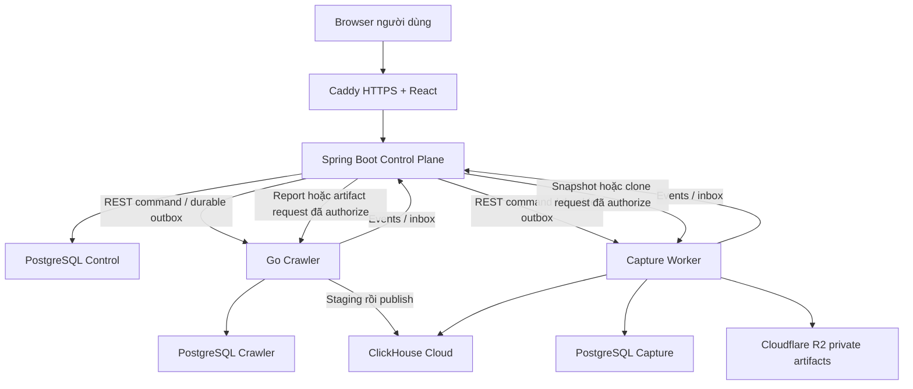

# WebLens — Báo cáo hiện trạng để đánh giá portfolio và CV

**Ngày tổng hợp:** 03/10/2026. Kiểm tra public endpoint lúc **13:17 UTC / 20:17 UTC+7**.

**Mục đích:** cung cấp một bản mô tả đủ thông tin để ChatGPT hoặc nhà tuyển dụng đánh giá dự án. Báo cáo phân biệt tính năng trong source, bằng chứng chạy thực tế và kế hoạch chưa triển khai. Đây là đánh giá kỹ thuật của dự án cá nhân, không phải chứng nhận bảo mật hay cam kết tuyển dụng.

## 1. Tóm tắt có thể gửi ngay cho người đánh giá

WebLens là ứng dụng hỗ trợ kỹ sư đăng ký website, chạy crawl có giới hạn, theo dõi tiến độ và xem bằng chứng kỹ thuật theo từng trang. Ngoài crawl HTTP, dự án có worker browser riêng để thu rendered HTML, screenshot, tài nguyên và network metadata; có workflow đóng gói clone tĩnh để tải xuống.

Stack chính gồm **React/TypeScript, Java 21/Spring Boot, Go, Node.js/Playwright/Camoufox, PostgreSQL, ClickHouse Cloud và Cloudflare R2**. Ba service ứng dụng được tách theo trách nhiệm: Control Plane, Crawler và Capture Worker. Control Plane giữ cấu trúc modular bên trong.

Các điểm kỹ thuật đáng chú ý: JWT/refresh rotation, dữ liệu theo owner, command outbox/event inbox, idempotency, state machine, lease/heartbeat/fencing, hàng đợi crawl lưu bền vững, staging analytics, report có phân trang và đối chiếu trạng thái giữa service. Production có domain HTTPS, Windows service, release artifact, kiểm tra hash và cơ chế rollback.

Dự án đã có bằng chứng tải trên production. Lượt mới nhất yêu cầu 150 scan × 1.000 trang đồng thời 150 API VU trong 10 phút: **146 scan được nhận và hoàn tất, 146.000 trang, khoảng 20,42 trang/giây, p95 terminal event lag 0,486 giây**. API có **27.867 request, 3 lỗi, p95 1,030 giây**. Tuy nhiên, **4 request tạo scan timeout và toàn bài vẫn FAILED_ACCEPTANCE_CRITERIA**. Chưa chứng minh production phục vụ tốt 500 hoặc 1.000 người hoạt động liên tục.

**Nhận định của người lập báo cáo:** đủ chất liệu để đưa vào portfolio/CV cho vị trí Java Backend hoặc Backend Intern/Junior, nếu chủ dự án có thể giải thích và vận hành phần đã xây dựng. Dự án có chiều sâu hơn một ứng dụng CRUD thông thường. Việc mô tả là hệ thống production hoàn thiện, có AI phân tích nguyên nhân, hoặc đã phục vụ ổn định 500/1.000 người sẽ vượt quá bằng chứng hiện có.

Đối với Fullstack, cần xem thêm demo giao diện và hành trình sản phẩm. Lần tổng hợp này đọc source frontend, không thực hiện một lượt đánh giá trực quan hoặc toàn bộ hành trình browser mới.

## 2. Cách đọc trạng thái trong báo cáo

| Nhãn | Ý nghĩa |
| --- | --- |
| Có trong source | Có implementation và contract trong checkout được đọc; chưa mặc định mọi nhánh đã được kiểm thử trên production |
| Đã kiểm chứng | Có kết quả test, smoke hoặc benchmark xác định rõ môi trường và thời điểm |
| Chưa đủ bằng chứng | Chưa có kiểm chứng đầy đủ hoặc issue cũ chưa được đóng bằng evidence mới |
| Kế hoạch/thử nghiệm | Proposal hoặc công cụ đánh giá; chưa phải runtime production |

Checkout chính đang có nhiều thay đổi chưa commit. Bản backend/crawler được đo mới nhất có source commit riêng **91f1d35e0944573af7904648908b58430dd56f4f**. Không đồng nhất checkout hiện tại với toàn bộ code đang chạy trên production.

## 3. Bài toán sản phẩm và phạm vi

### Người dùng dự kiến

- Developer cá nhân, freelancer và nhóm phát triển nhỏ quản lý website.
- Người cần biết một lần crawl thu được gì, trang nào lỗi, bằng chứng nằm ở đâu và trạng thái scan có đáng tin không.
- Người muốn thu snapshot hoặc bản đóng gói tĩnh phục vụ kiểm tra kỹ thuật.

Nhóm người dùng này là giả thuyết trong tài liệu sản phẩm. Chưa có bằng chứng trong lần tổng hợp này về khách hàng trả phí, doanh thu, retention hoặc product-market fit.

### Hành trình chính đã có implementation

1. Đăng ký/đăng nhập.
2. Đăng ký website theo tài khoản.
3. Tạo scan có giới hạn.
4. Xem trạng thái, tiến độ và yêu cầu hủy.
5. Xem lịch sử scan, danh sách trang và bằng chứng chi tiết.
6. Tạo browser capture cho trang đủ điều kiện, xem snapshot/screenshot.
7. Tạo Design Clone từ URL, theo dõi render và tải archive.

Mục tiêu dài hạn có yếu tố AI, nhưng sản phẩm hiện tại chủ yếu là **thu thập và trình bày bằng chứng theo luật xác định**.

## 4. Những tính năng hiện có

### 4.1. Tài khoản, phiên và phân quyền

| Khả năng | Hiện trạng |
| --- | --- |
| Đăng ký, đăng nhập, lấy user hiện tại | Có controller/service và frontend; có isolated API smoke và production smoke |
| JWT access token | Có Spring Security resource server và validation |
| Refresh token rotation | Có session persistence, token/hash kiểm tra, khóa khi rotation |
| Logout và revoke refresh session | Có implementation và test |
| Hash mật khẩu | BCrypt trong source, cost 12 |
| Cookie và CSRF | Refresh cookie HttpOnly/SameSite Strict; Secure theo cấu hình; double-submit CSRF cho refresh/logout |
| Frontend xử lý refresh | Access token trong RAM, chỉ một refresh đang chạy dùng chung, thử lại request sau refresh thành công |
| Owner isolation | Website/scan/report/capture/clone truy cập theo owner; có kiểm tra cross-owner |

Không thấy implementation xác minh email, quên/reset mật khẩu, OAuth/social login, MFA, organization/team hoặc admin console trong phạm vi đã đọc. Không trình bày chúng là chức năng đã có.

Public login/registration chưa có bằng chứng chính sách giới hạn thử đăng nhập được triển khai; xem mục bảo mật.

### 4.2. Website và dashboard

- Tạo website từ URL và kiểm tra target hợp lệ.
- Danh sách website của user, phân trang.
- Xem website, đổi tên và archive website.
- Xem scan gần nhất và lịch sử scan của website.
- Dashboard summary API theo user.

Thao tác DELETE website có nghĩa archive theo contract hiện có; không nên mô tả là xóa tức thì toàn bộ dữ liệu ở mọi storage.

### 4.3. Scan và crawler

- Tạo scan qua API bất đồng bộ, trả accepted khi nhận yêu cầu.
- Snapshot cấu hình của từng scan: giới hạn trang/depth/thời gian/concurrency và các bounds liên quan.
- Idempotency cho yêu cầu và command, tránh tạo công việc trùng khi giao lại hợp lệ.
- Trạng thái QUEUED, RUNNING, CANCEL_REQUESTED và terminal COMPLETED/PARTIAL_SUCCESS/FAILED/CANCELLED.
- Theo dõi tiến độ, dữ liệu một phần và lý do terminal.
- Hủy scan; kết quả đã công bố trước hủy vẫn được giữ theo contract.
- Crawl HTTP(S), phát hiện liên kết HTML, chuẩn hóa URL, deduplicate trong scope scan.
- Xử lý redirect, timeout, kích thước response, content type và phân loại lỗi.
- Giới hạn request theo host, bounded retry và reclaim lease hết hạn.
- Workflow/frontier lưu trong PostgreSQL thay vì chỉ giữ queue trong RAM.

UI cập nhật bằng **polling**. Không có bằng chứng SSE/WebSocket đang dùng để truyền tiến độ.

**Giới hạn cần ghi đúng:** sitemap/index discovery được audit 27/09 ghi là chưa có; không tìm thấy bằng chứng đóng issue trong các kết quả mới đã đọc. Crawler hiện **không cưỡng chế robots.txt** theo quyết định sản phẩm. Không tuyên bố crawler tuân thủ robots.txt.

### 4.4. Page evidence và report

Contract có các nhóm dữ liệu:

- URL/path, HTTP status, outcome, thời điểm quan sát.
- Response bytes, thời gian phản hồi và timing HTTP.
- Title, meta description/keywords, canonical và canonical relation.
- Meta robots, X-Robots-Tag, ngôn ngữ HTML, indexability và lý do.
- Heading H1–H6, hreflang, Open Graph và structured-data summary.
- Số link, image, script, stylesheet.
- Findings có rule/version, mức độ, code và evidence.

Ví dụ luật thực tế trong crawler: title thiếu, meta description thiếu, H1 thiếu, ảnh thiếu text alternative. Chúng phản ánh HTML và cách đo tại thời điểm crawl; không tương đương một audit SEO/accessibility đầy đủ.

Danh sách trang hỗ trợ bộ lọc và cursor pagination. Website/history dùng page-number pagination. Public report đi qua Control Plane để kiểm tra owner, rồi truy vấn data plane/analytics.

### 4.5. Browser capture và snapshot

- Worker riêng thực thi JavaScript của website bằng browser.
- Camoufox là engine mặc định theo ADR-015; Chromium qua Playwright là lựa chọn thủ công.
- Thu rendered HTML, screenshot, eligible resource và network metadata có giới hạn.
- Có measurement LCP/CLS/TTFB trong code, trạng thái khi không có dữ liệu; không nên gọi là Core Web Vitals của người dùng thật hoặc chứng nhận Lighthouse.
- Hash nội dung/artifact, lưu artifact lớn ngoài database.
- Snapshot viewer, screenshot và resource download có owner authorization.
- Có lifecycle, retry, lease và cleanup trong implementation.

Đã có test source và browser smoke được ghi trong tài liệu. Tuy nhiên, bằng chứng tải 146.000 trang mới nhất là **HTTP crawler**, không phải 146.000 browser-render hoặc screenshot. Lần báo cáo này chưa chạy lại đầy đủ capture + R2 + authorization journey trên production.

### 4.6. Clone tĩnh một trang và Design Clone

**Clone một trang:** best-effort archive gồm HTML sau render và resource hợp lệ cùng origin, manifest, retention tải 7 ngày. Giới hạn sản phẩm được tài liệu hóa: 100 file, 50 MiB input, 64 MiB archive.

**Design Clone:** nhận URL, tự tạo scan mới, chọn trang đại diện theo chức năng/route/layout, render ứng viên, deduplicate asset giữa trang và đóng gói archive. Mục tiêu là giữ thiết kế/luồng đại diện; không cam kết sao lưu mọi URL có nội dung hoặc locale khác nhau.

Có API xem tiến độ/render monitor, danh sách clone, hủy và tải artifact. Với website cần login, có phiên browser tạm qua screenshot/action, user tự nhập login/OTP và xác nhận tiếp tục. Theo contract, một phiên trên worker, TTL tối đa 10 phút, cookie/input chỉ trong RAM và mất khi worker restart; đây không phải dịch vụ lưu tài khoản bên thứ ba.

Archive là **download-only**; ứng dụng không chạy HTML/JS của archive trên origin của WebLens. Clone không tái tạo backend, database, API riêng hoặc source project gốc. Không bảo đảm vượt CAPTCHA/WAF/Cloudflare.

Các mức cấu hình lớn trong README như 100.000 trang hoặc hàng chục GiB archive **không phải capacity đã benchmark**.

## 5. Kiến trúc và công nghệ

### 5.1. Thành phần

| Thành phần | Công nghệ trong source | Trách nhiệm |
| --- | --- | --- |
| Frontend | React 19, TypeScript, Vite, React Router | UI, auth state, gọi API, polling, evidence/snapshot/clone viewer |
| Control Plane | Java 21, Spring Boot 3.5.16, Spring Security, JPA/Hibernate, Flyway | Auth, ownership, public API/lifecycle, outbox/inbox, report facade |
| Crawler | Go; pgx, goquery, ClickHouse client | Crawl, frontier, host scheduling, lease, parse/findings, analytics publication |
| Capture Worker | Node.js/TypeScript, Playwright, Camoufox, PostgreSQL/ClickHouse/S3 clients | Browser isolation, snapshot/resource, clone workflow/archive |
| Workflow database | PostgreSQL | Transactional state, phiên, lease, command/event, staging |
| Analytical database | ClickHouse | Page/metric/finding/link và browser/network analytics |
| Artifact storage | S3-compatible API | Screenshot, resource, snapshot/archive lớn |
| Public edge | Caddy | HTTPS, static frontend, reverse proxy tới backend |

Các version là từ source/manifest được đọc; không khẳng định từng package trong checkout chính là version đang chạy của mọi service.

Ba PostgreSQL database/role là phân tách logic trên host production hiện tại, không phải bằng chứng ba database server độc lập hoặc high availability.

### 5.2. Messaging production hiện tại

**Chưa dùng RabbitMQ hoặc Kafka trong runtime production.**

Đang dùng REST giữa service cùng PostgreSQL outbox/inbox:

1. Control Plane lưu state và command bền vững.
2. Dispatcher gửi command sang worker.
3. Inbox đối chiếu identity/payload để áp dụng idempotent.
4. Worker ghi event vào outbox.
5. Control inbox cập nhật projection, đối chiếu version/status.

Mô hình là giao lại có thể xảy ra và xử lý idempotent; không tuyên bố exactly-once delivery. Broker cũng không thay thế owner checks, inbox, transaction hoặc fencing.

### 5.3. Các vấn đề hệ thống đã có cách xử lý

- **Worker chậm hoặc chết:** lease/heartbeat/reclaim và fencing ngăn kết quả worker cũ ghi đè sau khi lease thay thế.
- **Nhiều worker cùng lấy việc:** claim/row locking, có SKIP LOCKED trong scheduler.
- **Discovery trùng:** normalized URL và constraint trong scope scan.
- **Command/event giao lại hoặc sai thứ tự:** identity, payload/version checks và inbox.
- **Analytics chưa publish xong:** durable staging, receipt/watermark và đối chiếu trước terminal/report.
- **Cancel đối đầu completion:** state machine và test concurrency; không sửa nhãn lịch sử để che lỗi.
- **Browser chạy nội dung không tin cậy:** worker tách riêng, SafeProxy và bounds; containment ở OS vẫn là gap cần xác minh.

Các cơ chế này có test cụ thể, nhưng không chứng minh mọi outage/restart của nhiều datastore đã được kiểm thử.

## 6. Production và cloud

### 6.1. Những gì đã triển khai

Theo hướng dẫn production và bằng chứng release:

- Windows-native VPS; các service PostgreSQL, Backend, Crawler, Capture Worker và Caddy.
- PostgreSQL 17 self-hosted, chỉ listen loopback, database/role theo service.
- **ClickHouse Cloud** cho analytics và **Cloudflare R2** cho object artifacts.
- Domain HTTPS: [jobnext.top](https://jobnext.top/).
- Caddy reverse proxy tới một backend upstream; chưa có bằng chứng load balancing nhiều backend instance.
- Release directory và junction `current`, health checks, artifact SHA-256, rollback.
- GitHub Actions build/test/package; VPS scheduled task pull deployment release theo chu kỳ 5 phút.

Local Compose dùng PostgreSQL/ClickHouse/MinIO; không lấy cấu hình local này để mô tả provider production. Cũng không mô tả PostgreSQL production là managed cloud database. R2 là object storage, không phải relational/analytical database.

### 6.2. Kiểm tra public vừa thực hiện

| Request không có credential | Kết quả lúc 13:17 UTC ngày 03/10/2026 |
| --- | --- |
| GET trang chủ HTTPS | 200, HTML |
| GET `/release.json` | 200; commit `9e87e8b0c95ea1791dcc4814793e45b1e391ca36` |
| GET `/api/v1/me` | 401, problem JSON; phù hợp request chưa đăng nhập |

Ba GET này xác nhận frontend/edge và một route API có phản hồi tại thời điểm kiểm tra. Chúng không chứng minh dependency health, uptime nhiều ngày, login thành công hoặc toàn bộ feature E2E.

Release JSON công khai phản ánh base release. Backend/crawler đã có patch runtime riêng source **91f1d35…** được ghi trong manifest triển khai; không coi public base commit là hash source của cả hai binary patched. Frontend/capture không tự được coi là cùng commit với patch backend/crawler.

## 7. Bảo mật: đã có gì và còn gì

### Có implementation và bằng chứng kiểm tra

- JWT, refresh rotation/revocation, BCrypt và ownership.
- External input validation, Problem Detail không trả stack trace; correlation ID cho truy vết.
- CORS allowlist, CSRF refresh/logout và service token checks.
- Crawler SSRF policy kiểm DNS/IP/redirect, SafeDialer kiểm lúc kết nối.
- Capture SafeProxy và URL checks chặn private/loopback/link-local/reserved/IPv4-mapped IPv6; có regression test cho mapped loopback.
- Bounded timeout/response/request body/resource và retry.
- Artifact private và tải qua API đã authorize; không mặc định public R2 bucket/CDN URL.
- Redaction dữ liệu nhạy cảm trong pipeline capture; phiên browser login không được thiết kế để persist credential/cookie.

Audit 27/09 có 20 isolated live API assertions về JWT, invalid input, owner access, refresh/logout và scan/cancel. Không gọi đây là penetration test độc lập.

### Gap cần giữ công khai trong đánh giá nội bộ

1. **Auth throttling:** audit ghi thiếu rate limit/lockout cho login/registration; source auth và edge đã đọc chưa có bằng chứng remediation. Cần xử lý trước khi mở rộng public usage.
2. **Browser egress OS/network:** SafeProxy ở application layer đã có; chưa có proof policy Windows chặn bypass cho browser process. Tách service chưa đủ chứng minh network sandbox.
3. **Recovery/failure matrix:** chưa đầy đủ outage ClickHouse/R2, multi-service restart, in-flight browser cancellation và late publication.
4. **Secret/dependency audit:** có pattern scan tracked files và Node advisory check tại ngày audit; chưa phải historical secret scan hoặc chứng nhận không có CVE hôm nay cho mọi dependency.
5. **Robots/crawl policy:** hiện không enforce robots.txt; cần nói rõ cách dùng có quyền và giới hạn target, không quảng bá khả năng vượt bảo vệ website.

Backup/restore và global recovery chưa được chứng minh toàn diện. Chủ dự án cá nhân chấp nhận rủi ro mất dữ liệu khi đo tải, nên báo cáo không đặt việc bổ sung backup thành điều kiện mới để đưa portfolio vào CV. Tuy nhiên, không dùng waiver đó để tuyên bố có production disaster recovery hoặc SLA.

## 8. Kiểm thử và chất lượng engineering

### 8.1. Các lớp kiểm thử có trong dự án

- Backend unit/API, persistence integration, state machine, auth, ownership và architecture boundary.
- Go unit, fixture HTTP/parser/SSRF, PostgreSQL concurrency/lease/cancel và ClickHouse integration.
- Capture Worker unit, database/storage integration, browser/session, clone/archive và fixture E2E.
- Frontend Vitest/Testing Library: auth, website, scan, page detail, snapshot, clone, polling và API client.
- Build/typecheck/lint/vet, Go race checks, smoke trên packaged application.
- k6 API load, fixture crawl, telemetry và đối chiếu terminal/identity/analytics.

### 8.2. Kết quả có thể dẫn chứng

| Mốc | Bằng chứng | Giới hạn |
| --- | --- | --- |
| Audit 27/09 | Tổng hợp 264 checks: 239 passed, 0 failed, 25 skipped; build/lint/typecheck đạt | Tại mốc này readiness vẫn NO do gap và skips; không gọi 264/264 pass |
| Runtime candidate 03/10 | 36 selected backend unit + 14 integration tests passed; Go race có 105 pass actions gồm subtests; vet/cross-build/package đạt | Không phải số test unique toàn repo; không có coverage % được xác minh |
| Integration candidate 03/10 | PostgreSQL 17.6 và ClickHouse 26.3.39.7 thật trong môi trường local cô lập | Không thay thế mọi production outage/failover scenario |
| Production smoke sau patch | Auth/owner/website/scan/report/cancellation và terminal reconciliation đạt theo release evidence | Workload một trang và hủy tuần tự, không phải load test |
| Production mixed 150 + 150 | Evidence terminal, analytics, API và cleanup đầy đủ hơn; có lỗi giữ nguyên | Tổng acceptance FAILED |

Không cộng các mốc trên thành một con số “tất cả test đều pass”: chúng có thể chồng lặp, khác scope và khác revision.

Audit cũ ghi Go race chưa chạy, thiếu PG17/default Camoufox/analytics proof. Bằng chứng mới đã bổ sung Go race, PG17/ClickHouse candidate và terminal analytics production; production guide có Camoufox gamepad smoke/fix. Những bổ sung này không tự đóng toàn bộ capture lifecycle, storage outage hoặc recovery matrix cũ.

### 8.3. CI/CD có trong source

Workflow có các job backend, crawler, capture-worker và frontend; release chỉ chạy khi các job phụ thuộc thành công. Release Windows đóng gói artifact, publish lên GitHub và job deploy kiểm tra release activation.

Đó là workflow được cấu hình. Báo cáo này không truy xuất lịch sử GitHub Actions mới nhất, nên không khẳng định mọi pipeline đang xanh hoặc mọi thay đổi chưa commit đã qua CI.

### 8.4. Kiểm tra có thể tái chạy khi review code

Các entry point hiện có, chạy trong từng module với dependency test cần thiết:

| Module | Lệnh |
| --- | --- |
| Backend | `./mvnw.cmd verify` trên Windows |
| Frontend | `npm run lint`, `npm test`, `npm run build` |
| Crawler | `go test ./...`, `go vet ./...`; race cần môi trường hỗ trợ CGO/compiler |
| Capture Worker | `npm test`, `npm run test:integration`, `npm run typecheck`, `npm run build` |

Integration cần database/storage test riêng; không trỏ suite vào production. Lần lập báo cáo này không chạy lại full suite và không phát workload mới.

## 9. Kết quả tải production cần đưa cho người đánh giá

### 9.1. Lượt mới nhất: 150 scan + 150 API VU

Run **worker64-150-runtime-v1 / 20261003T062608Z**. Cấu hình worker 64, host concurrency 2, delay 1 giây. Scan tối đa 1.000 trang/tài khoản; dùng cùng 150 tài khoản cho API trong **10 phút đầu**.

| Chỉ số | Kết quả |
| --- | --- |
| Attempts tạo scan | 150 |
| HTTP 202 / admission timeout | 146 / 4 |
| Accepted scans terminal | 146 COMPLETED |
| Owner/status/version/message mismatch | 0 trong 146 scan đã nhận |
| Succeeded / failed crawl pages | 146.000 / 0 |
| Requested pages chưa thực hiện do admission | 4.000 |
| Analytics pages / receipt page rows | 146.000 / 146.000, đã đối chiếu |
| First crawler start → last finish | 1 giờ 59 phút 08,768 giây |
| Tổng throughput HTTP crawler | 20,4231 trang/giây |
| Queue p95: crawler accepted → started | 4,636 giây |
| Queue p95: Control created → started | 41,777 giây |
| Terminal finished → inbox processed p95 / max | 0,486 / 0,541 giây |
| Latest terminal outbox / inbox | 146 DELIVERED / 146 APPLIED |
| Scoped active/backlog/events/analytics cuối | 0 theo supplemental proof |
| API duration / VU | 10 phút / 150 |
| API requests / errors | 27.867 / 3 |
| API error rate | 0,010765% |
| API request rate | Khoảng 46,16 request/giây |
| API p95 / p99 | 1.030,47 / 1.677,43 ms |
| Pages endpoint p95 | 1.692,09 ms |
| Acceptance | FAILED_ACCEPTANCE_CRITERIA; k6 exit 99 |

**Diễn giải:** phần crawl đã nhận chạy ổn trong mẫu này và terminal state/analytics khớp. API error SLO <1% đạt, nhưng p95 <1 giây không đạt. Admission thành công chỉ 97,33%. Không gọi toàn bài PASS hoặc “150/150 scan hoàn tất”.

Ba API lỗi là 404 `SCAN_PAGE_NOT_FOUND` ở pages đầu lượt đo; root cause chưa được xác minh. Bốn timeout ở admission có status 0/code 1050 sau khoảng 5 giây. Caddy logs được giữ có đúng 146 admission POST/202, không thấy POST của bốn website còn lại; post-run DB không thấy scan/execution của chúng. Suy luận nghiêng về lấy/thiết lập kết nối HTTPS trước admission HTTP được quan sát, nhưng chưa phân biệt chắc DNS/TCP/TLS/network. Không gán lỗi cho ClickHouse hoặc logic backend khi chưa có bằng chứng.

Manifest/wrapper gốc lần lượt giữ FAILED_ACCEPTANCE_CRITERIA/RECOVERY_UNVERIFIED. Supplemental proof xác minh scoped terminal cleanup, routes/hosts off và test/collector process thoát. Không sửa kết quả gốc. Global DEAD/orphan PERSISTING ngoài scope vẫn unknown.

Hai loại queue wait có mốc bắt đầu khác nhau; không đổi tên để coi chúng là cùng một phép đo. Terminal event lag cũng không phải độ trễ của mọi progress event.

### 9.2. So với lượt 500 gần nhất dùng làm baseline

Baseline **worker64-500-after-claimfix / 20261002T095900Z**:

| Chỉ số | Lượt 500 trước | Lượt 150 sau |
| --- | --- | --- |
| Crawler hoàn tất | 500 scan / 500.000 trang | 146 accepted scan / 146.000 trang |
| Control projection | 464 COMPLETED, 36 sai CANCELLED | 146 COMPLETED, 0 mismatch |
| Throughput | Khoảng 19,52 trang/giây | 20,42 trang/giây |
| Thời gian tổng crawl | Khoảng 7 giờ 06 phút 54 giây | Khoảng 1 giờ 59 phút 09 giây |
| Control queue p95 | Khoảng 6 giờ 32 phút 48 giây | 41,78 giây |
| Terminal event lag p95 | Khoảng 98,23 phút | 0,486 giây |
| API error rate | 3,0023% | 0,010765% |
| API p95 | 5.703,58 ms | 1.030,47 ms |
| Pages p95 | 6.772,28 ms | 1.692,09 ms |

Lượt 500 có API 64.850 requests/1.947 errors và timeout chờ pool ClickHouse được chẩn đoán. Lỗi 36 projection lịch sử không được backfill để biến kết quả cũ thành tốt.

**Giới hạn so sánh:** workload sau nhẹ hơn. Số liệu là cải thiện quan sát được, chưa chứng minh hiệu quả riêng của từng patch hoặc capacity 500 sau sửa. Không viết trên CV rằng giảm API latency 82% ở cùng workload.

Workload dùng fixture có kiểm soát. Tốc độ sẽ phụ thuộc nội dung, target latency, host distribution, retry, browser capture và storage. 150 VU cũng không đồng nghĩa 150 người thật dùng liên tục trong gần hai giờ.

Ở 20,42 trang/giây, 500.000 trang tương đương khoảng 6 giờ 48 phút theo phép ngoại suy đơn giản; đây **không phải SLA**. Muốn hoàn thành 500.000 trang trong hai giờ cần trung bình khoảng 69,44 trang/giây, chưa được chứng minh ở runtime hiện tại.

## 10. Các tối ưu và nghiên cứu hiện có

### Đã có trong runtime backend/crawler được deploy và đo

- Page claim có mức song song hữu hạn, không tạo một polling loop cho mỗi cấu hình concurrency lớn.
- Giới hạn worker 64 trong bài đo, host scheduling và fair ordering theo tải lease/thời điểm.
- Sampling progress cùng state tối đa khoảng 1 lần/giây; terminal được ưu tiên phát ngay.
- Event publication song song hữu hạn giữa scan, giữ thứ tự version của một scan.
- ClickHouse connection budget 10, tách read 7/write 3 và giới hạn admission report.
- Empty report shortcut chỉ sau kiểm tra ownership và expected/published counters hợp lệ.
- Sửa state transition/cancellation, bổ sung test race/late terminal và đối chiếu projection.
- Tách password verification khỏi transaction ghi session theo runtime auth đã kiểm chứng.

Các thay đổi có thể được thảo luận trong phỏng vấn bằng trade-off: throughput, fairness, event ordering, transaction duration và pool contention. Không coi danh sách này là proof scale tuyến tính khi tăng worker.

### RabbitMQ: mới đánh giá local

Đã có tool Java riêng và **ADR-017 ở trạng thái Proposed**, chưa có adapter RabbitMQ trong application runtime.

Thử nghiệm local dùng RabbitMQ thật, nhưng consumer/inbox là mô phỏng trong RAM với delay 20 ms. Đo 150/300/500 synthetic command, ba lần mỗi mode, tổng 27 mẫu/8.550 command. Mẫu 500 có trung vị p95: HTTP tuần tự 22,098 giây, HTTP 4 sender 5,549 giây, RabbitMQ 4 consumer 4,232 giây.

Có kiểm mandatory return, redelivery, dedup/collision mô phỏng và persistent message qua graceful restart một container trên cùng disk. Chưa có thực handler/PostgreSQL, power loss, node failure, partition hoặc production mixed benchmark. Những số này không chứng minh 500 scan hoặc 500 API user được phục vụ.

Production command proof cho lượt 150: 146 command DELIVERED/146 inbox APPLIED, mỗi command một attempt; Control outbox created→delivered p95 khoảng 19,970 giây. Chưa tách được outbox wait, HTTP và DB thành từng nguyên nhân. Broker không giải quyết tự động public HTTPS admission timeout.

## 11. Những phần chưa được coi là đã hoàn thành

| Nhóm | Trạng thái hiện tại |
| --- | --- |
| AI phân tích nguyên nhân / chatbot kỹ thuật | Roadmap V3, chưa có bằng chứng product implementation |
| Scan comparison / regression | Roadmap V2 |
| Scheduled scan / alerts | Roadmap V4 |
| RAG / vector search / ML anomaly | Roadmap; không đưa vào danh sách đã làm |
| RabbitMQ runtime | Local evaluation, proposal |
| Kafka, Redis, Kubernetes, multi-region | Chưa có trong kiến trúc production hiện tại |
| High availability / multi-backend load balancing | Chưa được chứng minh |
| 500/1.000 người hoạt động liên tục với SLO đạt | Chưa được chứng minh; phạm vi 1.000 còn mở |
| Full SEO/security/accessibility audit platform | Ngoài phạm vi V1/V1.5 |
| Full disaster recovery, RPO/RTO | Chưa có proof toàn diện |
| Comprehensive observability | Có health/correlation/log, timers và telemetry tải; chưa chứng minh monitoring/alerts vận hành liên tục đầy đủ |
| Mọi capture/clone failure path trên production | Chưa có kiểm chứng hoàn chỉnh |

OpenAPI/Swagger có cấu hình trong backend, không mặc định đang mở public. README có các default lớn và một số mô tả storage local; production provider/capacity phải dùng evidence deployment và benchmark.

## 12. Giá trị dự án đối với nhà tuyển dụng

### Những điểm có thể chứng minh năng lực

1. **Backend ngoài CRUD:** async workflow, transaction, idempotency, authorization và state consistency.
2. **Concurrency thực tế:** page claim, unique URL, lease, stale worker, cancel/completion race.
3. **Nhiều loại datastore đúng vai trò:** PostgreSQL state, ClickHouse analytics, R2 artifact.
4. **API và frontend tích hợp:** auth/session, polling, phân trang, lỗi và evidence.
5. **Vận hành:** packaged release, HTTPS, Windows services, rollout/rollback, hash và smoke.
6. **Debug hiệu năng bằng bằng chứng:** giữ SLO failures, phân biệt HTTP timeout với DB diagnostic timeout, reconcile state/page/event.
7. **Quyết định kiến trúc:** thử HTTP song song và broker trước khi thêm runtime dependency.

### Điều người đánh giá chưa thể suy ra chỉ từ repository

- Mức độ chủ dự án tự hiểu/tự viết từng phần, mức hỗ trợ từ AI.
- Khả năng sửa/debug khi phỏng vấn trực tiếp.
- Mức độ hoàn thiện UI, accessibility và trải nghiệm mobile.
- Số user thật, business impact hoặc production uptime.
- Độ ổn định khi target là nhiều website thật với kích thước/nội dung khác fixture.

Có sử dụng AI trong quá trình phát triển. Không invent tỷ lệ code tự viết hoặc AI viết. Giá trị portfolio phụ thuộc việc chủ dự án hiểu, kiểm tra và chịu trách nhiệm với implementation, giải thích được decision và failure.

### Provenance và giấy phép

Crawler có nguồn gốc fork CrawlObserver, AGPL-3.0; static clone có Pagesource adapter/provenance. Cần giới thiệu rõ phần tái sử dụng và phần integration/workflow đã bổ sung. Không nói toàn bộ crawler/browser engine do mình tự xây từ đầu. Tài liệu licensing/notice có trong hướng kiến trúc, nhưng lần này không xác minh legal review hoặc toàn bộ nghĩa vụ source distribution đã hoàn tất.

## 13. Những việc nên chuẩn bị trước khi gửi CV

Đây là thứ tự đề xuất cho **hồ sơ tuyển dụng**, không phải yêu cầu tự deploy hoặc chạy thêm tải.

### Ưu tiên 1 — Người xem hiểu và thử được dự án

- README mở đầu bằng bài toán, feature thật, kiến trúc, link demo và giới hạn rõ.
- Chọn một GitHub repository chính. Checkout có hai remote chủ sở hữu khác nhau; kiểm tra link public và revision trước khi gửi. Lần tổng hợp này chưa xác minh quyền truy cập anonymous của repo.
- Demo video ngắn: đăng nhập → website → scan → progress → report → snapshot/clone.
- Có một scan mẫu nhỏ đã hoàn tất để recruiter xem ngay, không phải chờ hai giờ.
- Nếu dùng tài khoản demo, cô lập quyền và dữ liệu; chưa có xác nhận một demo account an toàn đã sẵn sàng.
- Screenshot ngắn và hướng dẫn chạy/test cục bộ. Không đặt credential thật hoặc seed load test vào tài liệu gửi đi.

### Ưu tiên 2 — Đóng các lỗi ảnh hưởng demo và public exposure

- Bổ sung/xác minh auth throttling.
- Xác minh OS egress boundary của browser worker.
- Giải thích và sửa hoặc thể hiện đúng ba pages 404, bốn admission timeout.
- Giữ UI phân biệt queued/running/partial/failed và data chưa publish; không hiện hoàn tất giả.
- Thực hiện một hành trình production nhỏ đầy đủ với capture/clone và hai owner, có lưu evidence.

### Ưu tiên 3 — Làm rõ chất lượng engineering

- Bảo đảm snapshot code được gửi là revision tái build được, test scope và skips rõ.
- Tóm tắt một bug tiêu biểu: triệu chứng → giả thuyết → evidence → root cause → fix → kiểm chứng.
- Đồng bộ mô tả cloud/default/capacity giữa README và báo cáo mới.
- Chọn 3–4 câu chuyện kỹ thuật có thể giải thích sâu thay vì liệt kê mọi công nghệ.

Không cần thêm Kafka/Kubernetes hoặc bắt buộc vượt benchmark 500 để có portfolio hợp lệ. Benchmark tiếp theo phục vụ mục tiêu capacity; hồ sơ tuyển dụng cần demo rõ và năng lực giải thích trước.

## 14. Gợi ý mô tả trên CV

### Bản tiếng Việt

**WebLens — Nền tảng crawl và thu thập bằng chứng website**

Java 21, Spring Boot, React/TypeScript, Go, PostgreSQL, ClickHouse, Playwright/Camoufox, S3-compatible storage.

- Phát triển luồng đăng ký website, bounded scan, theo dõi/hủy scan và xem page evidence; tích hợp JWT/refresh rotation và phân quyền theo owner.
- Tích hợp Control Plane, Go crawler fork và browser worker riêng bằng REST + PostgreSQL outbox/inbox; triển khai idempotency, lease/fencing và staging analytics.
- Deploy lên Windows VPS với HTTPS, release artifact/hash, smoke và rollback; kiểm chứng 146 accepted scan xử lý 146.000 trang trong khoảng 119 phút trên fixture production.
- Đo API bằng k6 tại 150 VU trong 10 phút: 27.867 requests, error rate 0,0108%, p95 1,03 giây; ghi nhận admission timeout và latency SLO chưa đạt.

Chỉ dùng động từ “phát triển/triển khai” cho phần chủ dự án thực sự sở hữu và hiểu. Có thể rút còn ba bullet trên CV, đưa failure detail và evidence đầy đủ vào README.

### Bản tiếng Anh

**WebLens — Website crawling and evidence platform**

- Built website registration, bounded scans, progress/cancellation and page evidence APIs with Java 21/Spring Boot, JWT refresh rotation and owner-scoped authorization.
- Integrated a Go crawler fork and an isolated browser worker using REST and PostgreSQL outbox/inbox, with idempotency, leases/fencing and durable analytics staging.
- Deployed to a Windows VPS with HTTPS and release verification; benchmarked 146 accepted scans processing 146,000 pages in approximately 119 minutes on a controlled production fixture.
- Measured 27,867 API requests at 150 VUs over 10 minutes: 0.0108% errors and 1.03 s p95; documented remaining admission timeouts and latency SLO failures.

### Những tuyên bố cần tránh

- “Đã phục vụ 500/1.000 user đồng thời ổn định.”
- “150/150 scan thành công, toàn bộ test pass.”
- “AI tìm root cause / RAG đã triển khai.”
- “RabbitMQ/Kafka đang điều phối production.”
- “Exactly-once delivery, không thể mất dữ liệu, bảo mật tuyệt đối.”
- “100.000 trang/scan hoặc 10.000 concurrency đã được chứng minh.”
- “Toàn bộ crawler tự viết” hoặc “clone lại được source/backend của mọi website”.
- “Giảm latency X% ở cùng tải” khi baseline và lần đo sau khác workload.

## 15. Những câu hỏi chủ dự án nên trả lời được

1. Tại sao auth/website/scan cùng Control Plane, còn crawler và browser tách service?
2. Transaction kết thúc ở đâu? Vì sao outbox/inbox cần thiết dù đã gọi HTTP?
3. Publisher xác nhận khác gì consumer áp dụng? Vì sao không gọi exactly-once?
4. Khi worker chết, lease hết hạn và worker cũ quay lại thì điều gì ngăn ghi sai?
5. Cancel đến trước create hoặc terminal event đến muộn xử lý thế nào?
6. Tại sao dùng PostgreSQL cho workflow và ClickHouse cho evidence? Publish/receipt/watermark có ý nghĩa gì?
7. Vì sao pool ClickHouse bị contention, read/write budget giúp gì và có trade-off nào?
8. Tại sao queue của Control và crawler khác nhau? Làm sao tách dispatch wait khỏi crawl queue?
9. Kết quả 150 + 150 không đạt chỗ nào, bốn timeout biết chắc gì và chưa biết gì?
10. Vì sao 146.000 HTTP pages không chứng minh throughput browser capture?
11. SSRF ở DNS/redirect/proxy xử lý ở đâu, OS containment còn thiếu gì?
12. Tại sao thử HTTP song song trước khi chuyển sang RabbitMQ? Broker thêm failure mode nào?
13. Clone tĩnh khác source code gốc thế nào? Cookie login tạm được xử lý ra sao?
14. Cách tái build release, rollback và xác định binary/source đang chạy?
15. Phần nào dựa trên fork, phần nào đã tự thay đổi; giấy phép và AI hỗ trợ được trình bày thế nào?

Không cần thuộc thuật ngữ: nên giải thích bằng một luồng request và một tình huống lỗi có evidence.

## 16. Prompt gửi ChatGPT cùng toàn bộ báo cáo

> Tôi đang chuẩn bị đưa WebLens vào CV ứng tuyển Java Backend Intern/Junior hoặc Fullstack Junior. Dưới đây là báo cáo hiện trạng có phân biệt source, production evidence, benchmark thất bại và roadmap. Hãy đánh giá như một nhà tuyển dụng kỹ thuật, không mặc định mọi feature trong source đều đã chạy ổn trên production.
>
> 1. Dự án hiện có đủ để đưa vào CV và gửi demo không? Trả lời riêng cho Backend và Fullstack, nêu điều kiện cần.
> 2. Chọn năm điểm kỹ thuật mạnh nhất dựa trên evidence và các điểm đang yếu; đánh dấu điều chưa thể kết luận.
> 3. Phân biệt lỗi cần sửa trước khi public demo với tối ưu có thể làm sau; lập thứ tự công việc nhỏ nhất có ích.
> 4. Viết ba hoặc bốn bullet CV trung thực, không invent user thật, AI, broker production, test coverage, SLA hoặc capacity 500/1.000.
> 5. Soạn câu hỏi phỏng vấn để kiểm tra tôi hiểu transaction, outbox/inbox, lease/fencing, consistency, SSRF, performance và deploy.
> 6. Nêu thêm evidence/screenshot/demo cần xem để chốt đánh giá. Nếu chấm điểm, nói rõ tiêu chí và phần thiếu bằng chứng, không coi điểm số là đảm bảo tuyển dụng.
> 7. Đánh giá việc tái sử dụng crawler fork và AI hỗ trợ theo mức hiểu/sở hữu thực tế, không tự suy đoán tỷ lệ code tự viết.
>
> Lưu ý: lượt mới nhất có 146/150 admission thành công, toàn bài FAILED; 150 VU chỉ chạy 10 phút, HTTP crawl kéo dài khoảng hai giờ. So với lượt 500 trước là khác workload. RabbitMQ chỉ thử local bằng inbox mô phỏng. AI root-cause/RAG còn roadmap.

## 17. Nguồn và tính truy vết

Báo cáo đã đối chiếu tài liệu, controller/DTO, frontend routes/API client, package manifests, CI workflow và evidence được lưu. Những link local dưới đây phục vụ chủ dự án; người nhận ChatGPT có thể đánh giá bản mô tả này độc lập, nhưng cần gửi thêm file khi họ muốn audit nguyên liệu gốc.

| Nguồn | Nội dung kiểm chứng |
| --- | --- |
| [PRODUCT.md](C:/Users/HP/Desktop/Pet_project/docs/PRODUCT.md) và [REQUIREMENTS.md](C:/Users/HP/Desktop/Pet_project/docs/REQUIREMENTS.md) | Phạm vi V1/V1.5, clone, browser session, phần deferred |
| [ARCHITECTURE.md](C:/Users/HP/Desktop/Pet_project/docs/ARCHITECTURE.md) | Ba deployable, ownership, messaging, datastore |
| [Production guide](C:/Users/HP/Desktop/Pet_project/infra/production-windows/README.md) | Windows deployment, PG self-hosted, CH Cloud/R2, Camoufox/gamepad |
| [AppRouter](C:/Users/HP/Desktop/Pet_project/frontend/src/AppRouter.tsx) | Các màn hình thật trong source |
| [Scan page contract](C:/Users/HP/Desktop/Pet_project/backend/src/main/java/com/weblens/scan/dto/ScanPageResponse.java) | Dữ liệu report/evidence |
| [CI workflow](C:/Users/HP/Desktop/Pet_project/.github/workflows/ci-deploy.yml) | Job test/build/release/deploy được cấu hình |
| [Pre-load results](C:/Users/HP/Desktop/Pet_project/docs/testing/PRE_LOAD_TEST_RESULTS.md) | Test accounting 27/09 và các skips |
| [Security results](C:/Users/HP/Desktop/Pet_project/docs/testing/SECURITY_TEST_RESULTS.md) và [Known issues](C:/Users/HP/Desktop/Pet_project/docs/testing/KNOWN_ISSUES.md) | Security proof và gap tại mốc audit, cần đọc cùng cập nhật mới |
| [Runtime fix](C:/Users/HP/Desktop/Pet_project/docs/testing/PERFORMANCE_RUNTIME_FIX_2026-10-03.md) và [Release manifest](C:/Users/HP/Desktop/Pet_project/tmp/releases/runtime-verified-20261003/manifest.json) | Selected tests, source/hash, production smoke |
| [Load results](C:/Users/HP/Desktop/Pet_project/docs/testing/PERFORMANCE_LOAD_TEST_RESULTS.md) và [Execution](C:/Users/HP/Desktop/Pet_project/docs/testing/PERFORMANCE_OPTIMIZATION_EXECUTION.md) | 500 baseline, final 150 và các diagnostic mới |
| [Final analysis](C:/Users/HP/Desktop/Pet_project/tmp/load/phase8-worker64-150-runtime-v1-150x1000-20261003T062608Z/final-analysis.json) | Terminal/page/event/identity/cleanup của lượt 150 |
| [Dispatch evaluation](C:/Users/HP/Desktop/Pet_project/docs/testing/PERFORMANCE_DISPATCH_EVALUATION_2026-10-03.md) và [ADR-017](C:/Users/HP/Desktop/Pet_project/docs/adr/ADR-017-rabbitmq-command-transport-evaluation.md) | RabbitMQ local, giới hạn mô phỏng và proposal |

Backend deployed SHA-256: `e4bbd656fbb16f3e4a123dcacdd531ab9d3115b3bfe73f5e92873c05578309bb`.

Crawler deployed SHA-256: `7acd544fb1b1861192b462b975356397663fef71ce9e864b15c5ad3a7f52755e`.

**Xử lý thông tin khác thời điểm:** README mô tả nhiều default/local storage; dùng production guide và release/load evidence mới để xác định môi trường. Một số manifest/note trước benchmark còn ghi chưa đo sau fix; final results lúc 08:40 UTC và diagnostic sau đó là nguồn mới hơn cho kết quả tải. Không suy ra issue recovery đã đóng chỉ từ một smoke hoặc benchmark scoped thành công.

**Kết luận:** WebLens có thể được trình bày ngay như một portfolio backend có sản phẩm thật, kiểm thử và bài học vận hành. Giá trị thuyết phục nhất là hệ thống async có consistency và evidence, cùng khả năng giải thích lỗi/tối ưu. Hồ sơ nên ưu tiên demo dễ xem, revision tái build được và claim chính xác; mức hoàn thiện thương mại, bảo mật đầy đủ và capacity lớn vẫn cần thêm công việc và bằng chứng.
